- [Wks 1-4](#wks-1-4)
  - [Flavours of gradient descent:](#flavours-of-gradient-descent)
  - [Key terminology:](#key-terminology)
    - [Update equation](#update-equation)
  - [Simple Models](#simple-models)
    - [Linear regression](#linear-regression)
    - [Ridge Regression / Tikhonov Regression](#ridge-regression--tikhonov-regression)
    - [Lasso Regression](#lasso-regression)
    - [Logistic Regression](#logistic-regression)
    - [Classification](#classification)
  - [Complex Models](#complex-models)
    - [Convolutional](#convolutional)
      - [`nnx.Conv`](#nnxconv)
      - [`nnx.max_pool` / `nnx.avg_pool` / `nnx.min_pool`](#nnxmax_pool--nnxavg_pool--nnxmin_pool)
  - [Activation Functions](#activation-functions)
  - [Vanishing Gradients](#vanishing-gradients)
    - [Normalisation](#normalisation)
      - [Batch Norm](#batch-norm)
      - [Layer Norm](#layer-norm)
      - [Instance Normalisation](#instance-normalisation)
      - [Group Normalisation](#group-normalisation)
  - [Types of error](#types-of-error)
  - [Regularisation Methods](#regularisation-methods)
    - [Constrained Optimisation (Squared Norm Regularisatiion as Hard Constraint)](#constrained-optimisation-squared-norm-regularisatiion-as-hard-constraint)
    - [L2 Regularisation / Weight decay / Ridge regression / Tikhonov regularisation](#l2-regularisation--weight-decay--ridge-regression--tikhonov-regularisation)
    - [Dropout](#dropout)
  - [VC dimension](#vc-dimension)
  - [Perceptrons](#perceptrons)
    - [Analytic solution to linear regression](#analytic-solution-to-linear-regression)
- [Wk 5 Modern RNNs](#wk-5-modern-rnns)
  - [(VGG) 2 3x3 vs 1 5x5 Convolution](#vgg-2-3x3-vs-1-5x5-convolution)
  - [(NiN)](#nin)
  - [GoogLeNet](#googlenet)
- [Architectures](#architectures)
  - [LeNet](#lenet)
  - [AlexNet](#alexnet)
  - [VGG](#vgg)
  - [NiN](#nin-1)
  - [GoogLeNet](#googlenet-1)
  - [Batch Normalisation](#batch-normalisation)
- [Wk 6 Recurrent Neural Networks](#wk-6-recurrent-neural-networks)
  - [Coming From Non-Sequential Data](#coming-from-non-sequential-data)
  - [Sequence Modelling](#sequence-modelling)
    - [Intro](#intro)
    - [Sequence Models](#sequence-models)
    - [Markov Models](#markov-models)
    - [Converting Raw Text into Sequence Data](#converting-raw-text-into-sequence-data)
  - [Language Models](#language-models)
    - [Markov Models](#markov-models-1)
    - [Word Frequency](#word-frequency)
  - [Perplexity](#perplexity)
  - [Partitioning](#partitioning)
  - [Shortcomings of MLP](#shortcomings-of-mlp)
  - [Koren 2009](#koren-2009)
  - [Problems with Markov Models / n-grams](#problems-with-markov-models--n-grams)
  - [Training](#training)
  - [Recurrent Neural Networks with Hidden States](#recurrent-neural-networks-with-hidden-states)
  - [Weight matrix concatenation](#weight-matrix-concatenation)
  - [LSTM](#lstm)
    - [Plain](#plain)
    - [GRU](#gru)
  - [Deep RNN](#deep-rnn)
  - [Bidirectional RNN](#bidirectional-rnn)
  - [Sequence to Sequence Modelling](#sequence-to-sequence-modelling)
    - [Encoder Decoder Architecture](#encoder-decoder-architecture)
    - [Teacher Forcing](#teacher-forcing)
    - [Sequence to Sequence RNN Encoder-Decoder Model](#sequence-to-sequence-rnn-encoder-decoder-model)
    - [Multi-layer Sequence to Sequence RNN Encoder-Decoder Model](#multi-layer-sequence-to-sequence-rnn-encoder-decoder-model)
  - [Evaluation of Predicted Sequence](#evaluation-of-predicted-sequence)
  - [ANKI NOTES UP TO HERE](#anki-notes-up-to-here)
  - [Search Strategies](#search-strategies)
    - [Greedy Search](#greedy-search)
    - [Exhaustive Search](#exhaustive-search)
    - [Sequence Decoding Beam Search](#sequence-decoding-beam-search)
- [Wk 6.1 Embeddings](#wk-61-embeddings)
  - [What we actually do](#what-we-actually-do)
  - [Byte Pair Encoding (BPE)](#byte-pair-encoding-bpe)
  - [Embeddings](#embeddings)
  - [Word2Vec](#word2vec)
  - [GloVe](#glove)
  - [ELMo](#elmo)
  - [BERT](#bert)
  - [Fancy BERT MCQ](#fancy-bert-mcq)
    - [Layer Details: Deng et al. DCQA](#layer-details-deng-et-al-dcqa)
- [Wk 9 Transformer](#wk-9-transformer)
  - [Issues with RNN](#issues-with-rnn)
  - [Queries Key and Values](#queries-key-and-values)
  - [Attention Scoring Functions](#attention-scoring-functions)
    - [Scaled Dot Production Attention](#scaled-dot-production-attention)
    - [Multilayer Perceptron Attention (Additive Attention)](#multilayer-perceptron-attention-additive-attention)
  - [Seq2Seq With Attention (Bahdanau Attention Mechanism)](#seq2seq-with-attention-bahdanau-attention-mechanism)
  - [Positional Encoding](#positional-encoding)
    - [Absolute positional information](#absolute-positional-information)
    - [Relative positional information](#relative-positional-information)
  - [(convenience function) Masked Softmax Operation](#convenience-function-masked-softmax-operation)
  - [Relative positional information explanation](#relative-positional-information-explanation)
- [9.1 Transformer](#91-transformer)
  - [Overview](#overview)
  - [Layer Details](#layer-details)
  - [FFN](#ffn)
- [Wk 10 LLM](#wk-10-llm)
  - [Perplexity](#perplexity-1)
  - [Definitions](#definitions)
  - [Pretraining](#pretraining)
- [Wk 11 LLM](#wk-11-llm)
  - ["Train on the Web"](#train-on-the-web)
    - [Data Sources](#data-sources)
    - [Training Curriculum](#training-curriculum)
    - [LLM Evaluation is becoming Unreliable](#llm-evaluation-is-becoming-unreliable)
  - [Decision Making when training NNs](#decision-making-when-training-nns)
  - [Power Law](#power-law)
    - [Overview](#overview-1)
    - [How to find optimal N and D](#how-to-find-optimal-n-and-d)
      - [Step 1: Try different model sizes](#step-1-try-different-model-sizes)
      - [Step 2: Determine loss using loss equation](#step-2-determine-loss-using-loss-equation)
      - [Step 3: Repeat 1 and 2 for varying compute budgets](#step-3-repeat-1-and-2-for-varying-compute-budgets)
  - [Takeaways from Kaplan et al. (2020)](#takeaways-from-kaplan-et-al-2020)
  - [Chinchilla enters the room. (2022)](#chinchilla-enters-the-room-2022)
  - [Intentional overtraining](#intentional-overtraining)
  - [Power law diminishing returns...](#power-law-diminishing-returns)
  - [Surprising performance from smaller models surpassing what pure scaling predicts](#surprising-performance-from-smaller-models-surpassing-what-pure-scaling-predicts)
    - [1. Training Curriculum (copied from above)](#1-training-curriculum-copied-from-above)
    - [2. User/Assistant Templates](#2-userassistant-templates)
    - [3. Supervised fine-tuning (SFT) using demonstrations of desired behaviour](#3-supervised-fine-tuning-sft-using-demonstrations-of-desired-behaviour)
      - [LIMA: Less Is More for Alignment](#lima-less-is-more-for-alignment)
  - [Reinforcement Learning](#reinforcement-learning)
    - [Challenges with SFT](#challenges-with-sft)
    - [RL for Human Feedback (RLHF)](#rl-for-human-feedback-rlhf)
    - [RL from "Verifiable" Rewards](#rl-from-verifiable-rewards)
    - [Rejection Fine-Tuning (RFT)](#rejection-fine-tuning-rft)
    - [Policy Gradient Algorithms (REINFORCE)](#policy-gradient-algorithms-reinforce)


# Wks 1-4

## Flavours of gradient descent:
- Batch gradient descent = uses whole batch per update
- Stochastic gradient descent = uses one random sample per update
- Minibatch gradient descent = uses subset of batch per update

## Key terminology:
A **logit** is raw, unnormalized output of neural network (pre Sigmoid or Softmax).

A **probability** is post activation function (post Sigmoid or Softmax).

### Update equation
$$w_{t} \leftarrow w_{t-1} - \eta \cdot \frac{\partial \mathcal{L}}{\partial w_{t-1}}$$

---

## Simple Models

### Linear regression

Loss functions:
- L1 loss (Manhattan loss)
    - $\mathcal{l} = |\hat{y}-y|$
    - $\mathcal{L} = \frac{1}{n}\sum_i^n|\hat{y}_i-y_i|$ (mean absolute error)
    - Pytorch (logits) `torch.nn.L1Loss`
    - Optax (logits) `N/A`
- L2 loss:
    - $\mathcal{l} = (\hat{y}-y)^2$
    - Optax (logits) `optax.l2_loss` or `optax.squared_error` (does not halve)
    - $\mathcal{L} = \frac{1}{n}\sum_i^n(\hat{y}_i-y_i)^2$ (mean squared error)
    - Pytorch (logits) `torch.nn.MSELoss` (note takes average)

Note:
- **L1 norm** (Manhattan distance): $\|\mathbf{w}\|_1 = \sum_k |w_k|$
- **L2 norm** (Straight line distance): $\|\mathbf{w}\|_2 = \sqrt{\sum_k w_k^2}$
- **L2 norm squared**: $\|\mathbf{w}\|_2^2 = \sum_k w_k^2$ 

### Ridge Regression / Tikhonov Regression

- Add $\frac{\lambda}{2}||\mathbf w||_2^2$ as error term to **linear regression**


### Lasso Regression

- Add $\lambda||\mathbf w||_1$ as error term to **linear regression**

---

### Logistic Regression


Loss functions:
- Pytorch (logits) `torch.nn.BCEWithLogitsLoss`
- Pytorch (probabilities) `torch.nn.BCELoss`
- Optax (logits) `optax.sigmoid_binary_cross_entropy`
- Optax (probabilities) `N/A`

Sigmoid/Logistic function:

$$
\begin{align*}
P(\text{Class } 1) &= \frac{e^{z_1}}{e^{z_1} + e^{z_2}} = \frac{\frac{e^{z_1}}{e^{z_1}}}{\frac{e^{z_1}}{e^{z_1}} + \frac{e^{z_2}}{e^{z_1}}} \\[10pt]
&= \frac{1}{1 + e^{z_2 - z_1}} = \frac{1}{1 + e^{-(z_1 - z_2)}}
\end{align*}
$$

By defining the difference between the logits as $z = z_1 - z_2$ we get:
$$
P(\text{Class } 1) = \frac{1}{1 + e^{-z}}
$$
The model will attempt to estimate the difference $z_1 - z_2$ directly (one output, $z$)

Binary cross-entropy loss: (Pytorch `BCELoss`)
$$l(y, \hat{y}) = - \left[ y \log(\hat{y}) + (1 - y) \log(1 - \hat{y}) \right]$$

---

### Classification
Loss functions:
- Pytorch (logits) `torch.nn.CrossEntropyLoss`
- Pytorch (probabilities) `torch.nn.NLLLoss`
- Optax (logits) `optax.softmax_cross_entropy` (also `optax.softmax_cross_entropy_with_integer_labels`)
- Optax (probabilities) `N/A`


Softmax:
$$\sigma(\mathbf{z})_i = \frac{e^{z_i}}{\sum_{j=1}^K e^{z_j}}$$

Cross-entropy loss: ($\hat y$ is output after softmax output)
$$
l(\mathbf{y}, \hat{\mathbf{y}}) = - \sum_{j=1}^q y_j \log \hat{y}_j.
$$

To actually implement we use: (o is output from nn)
$$\bar{o} \stackrel{\textrm{def}}{=} \max_k o_k$$
$$
\log \hat{y}_j =
\log \frac{\exp(o_j - \bar{o})}{\sum_k \exp (o_k - \bar{o})} =
o_j - \bar{o} - \log \sum_k \exp (o_k - \bar{o})
$$

Also note that if our labels are one-hot we don't need to sum over all the outputs: $l(\mathbf{y}, \hat{\mathbf{y}}) = - \sum_{j=1}^q y_j \log \hat{y}_j$ turns into $l(\mathbf{y}, \hat{\mathbf{y}}) = - y_c \log \hat{y}_c = -\log \hat{y}_c$. (c stands for correct class)

Overall:
$$l = - \left( o_c - \bar{o} - \log \sum_k \exp(o_k - \bar{o}) \right)$$

## Complex Models

### Convolutional

MLP suffers 2 problems:

1. Translation invariance: In an MLP weights are tied to specific pixel indices, so if a feature in the input moved, it would no longer be detected.

2. Locality: In an MLP, a neuron is influenced by every single pixel in the image equally, however meaningful visual features are usually defined by small neighbourhoods of pixels close together.


---
Transposed convolution
- Other names: unconv or fractionally strided convolution
- Sometimes (incorrectly) called "deconvolution"

Transposed conv = input dilation by $(s - 1)$ and border padding of $(k - 1 - p_{\text{per side}})$, then standard conv with stride 1.

Output shape:
$$(s(n_h-1) + k - p_{\text{h total}}) \times (s(n_w-1) + k - p_{\text{w total}})$$

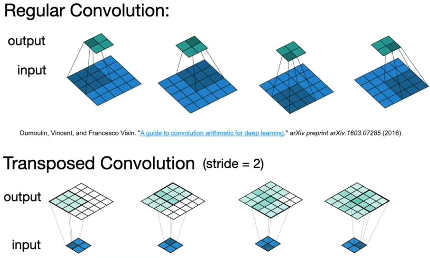
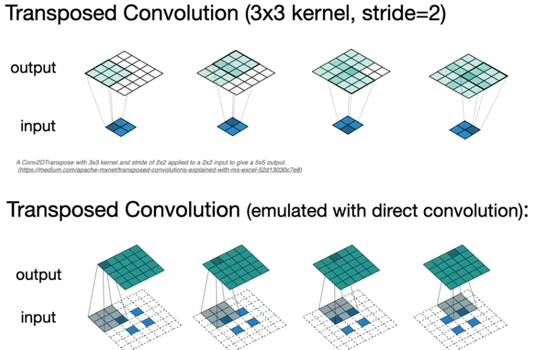
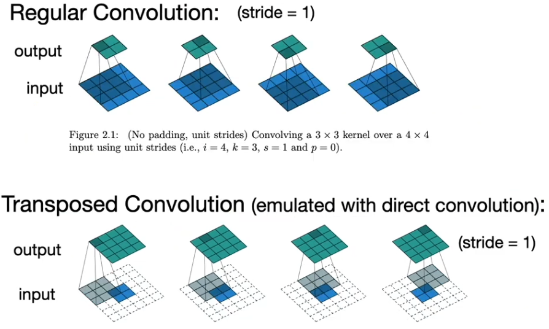


---

Mathematical operations:

1. Convolution ($f\ast g$)

    $$(f * g)(t) = \int f(\tau) \, g(t - \tau) \, d\tau$$

2. Cross-correlation ($f\star g$)

    $$(f \star g)(t) = \int f(\tau) \, g(t + \tau) \, d\tau$$

3. Autocorrelation ($f\star f$)

    $$(f \star f)(t) = \int f(\tau) \, f(t + \tau) \, d\tau$$

A CNN will use the cross-correlation operation.

Lets define:
- Image with dimensions $n_h \times n_w$
- Kernel size $k_h \times k_w$
- Padding $P_h \times P_w$ (adds a border of zero pixels to the image). $P$ is the sum of both sides, $p$ is each side.
- Stride $s_h \times s_w$

NOTE: Both `nnx` and `pytorch` use $p$ (per side), while the below formulas use $P$.

NOTE: In pytorch s must be 1 when using padding = "SAME", otherwise value error is thrown. Same restriction not present in FLAX NNX.

Then, excluding stride our shape will be:
$$([n_h + P_h] - k_h + 1) \times ([n_w + P_w] - k_w + 1)$$

Intuitively, for the shape to be the same we define $p = k - 1$

Adding stride:
$$\left\lfloor \frac{[n_h + P_h] - k_h + s_h}{s_h}\right\rfloor \times \left\lfloor \frac{[n_w + P_w] - k_w + s_w}{s_w}\right\rfloor$$

#### `nnx.Conv`
- in_features (int)
- out_features (int)
- kernel_size (tuple)
- padding:

| Option | Behaviour | Per-side? |
|---|---|---|
| `'SAME'` | Pads to preserve spatial dims at stride 1 | Handled automatically |
| `'VALID'` | No padding | N/A |
| `'CIRCULAR'` | Periodic boundary (wraps around) | Handled automatically |
| `'REFLECT'` | Reflects values across border | Handled automatically |
| `'CAUSAL'` | Left-pads only (1D only) | Handled automatically |
| `((low, high), ...)` | Explicit per-side padding per spatial dim | Yes, per-side |


Note:
- in_features: makes the kernel deeper (extends through input channels)
- out_features: makes more copies of the kernel (each learning different features)

#### `nnx.max_pool` / `nnx.avg_pool` / `nnx.min_pool`
- We can define kernel size and padding behaviour (only SAME, VALID or custom)
- No in_features or out_features. So in essence in_features = out_features.

Comparison:

- Max pool extracts most prominent features (like strong edges/text)
- Average pool retains more localised background information but dilutes sharp features

- Average pool is preferred in the final layers of a network before fully connected layers to aggregate the total presence of a feature across the entire image.


## Activation Functions

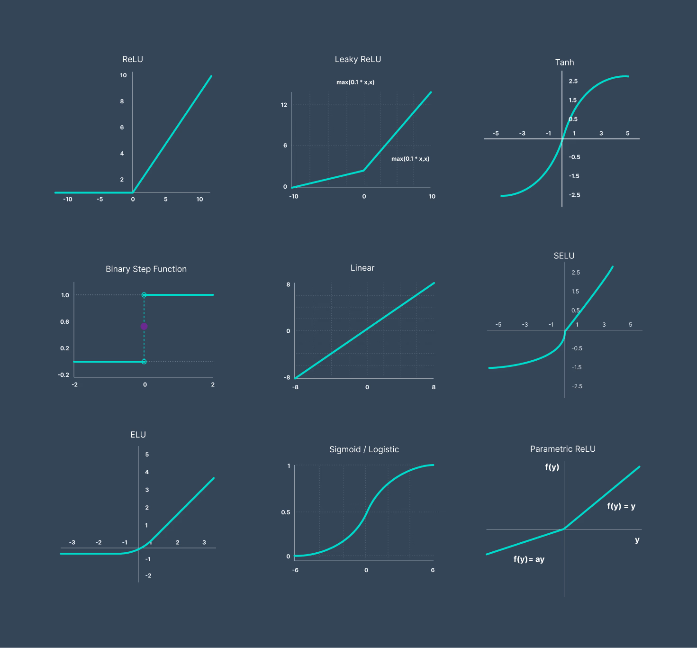

| Name    | Formula                           |
| ------- | --------------------------------- |
| Sigmoid | $\frac{1}{1+e^{-x}}$              |
| Tanh    | $\frac{1 - e^{-2x}}{1 + e^{-2x}}$ |
| ReLU    | $\max(0, x)$                      |

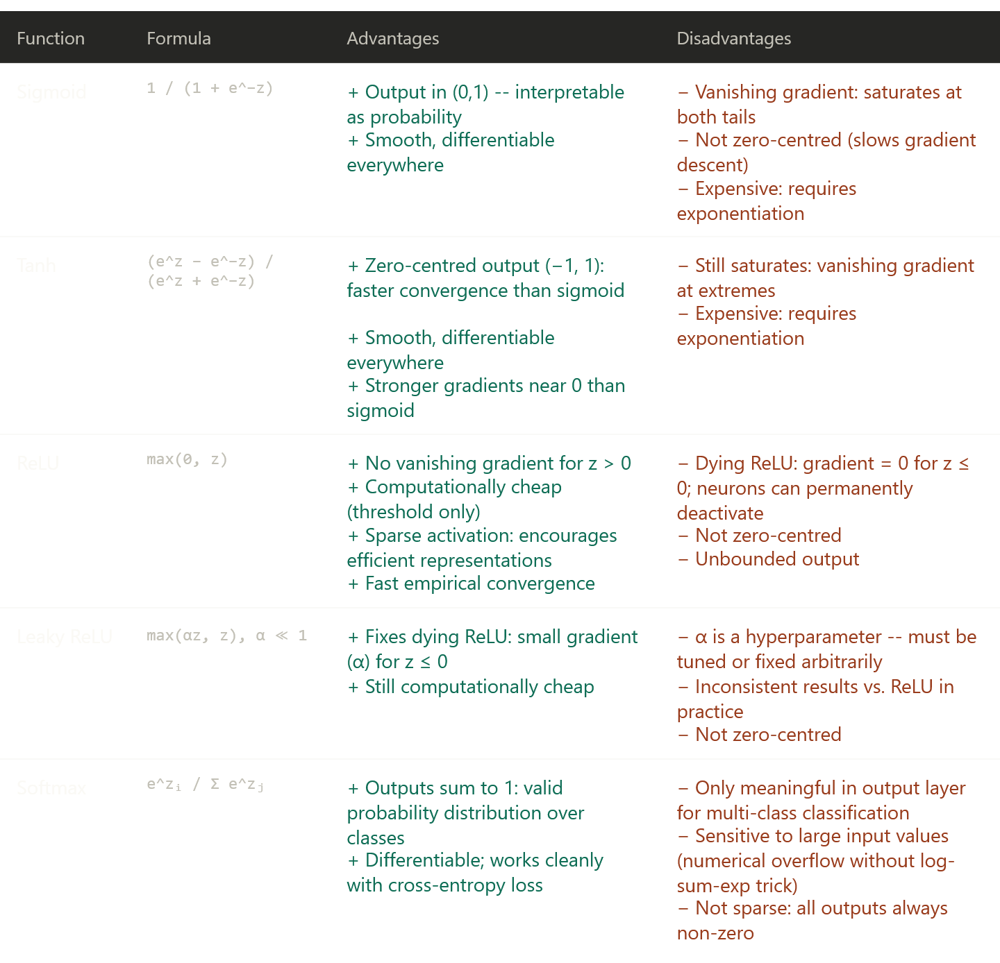

**On vanishing gradients:** Sigmoid's max gradient is ~0.25; tanh's is 1.0. In a deep network, repeated multiplication of these small values causes gradients to shrink exponentially toward the input layers, making early layers learn very slowly. ReLU's gradient of exactly 1 for z > 0 breaks this chain.

**On dying ReLU:** If a neuron receives consistently negative inputs (e.g. from a large learning rate update), its pre-activation is always < 0, gradient is always 0, weights never update. That neuron is "dead" for the rest of training. Leaky ReLU patches this with a slope of typically 0.01 for z ≤ 0.

## Vanishing Gradients

### Normalisation

Mostly taken from [this](https://dzdata.medium.com/the-different-types-of-normalizations-in-deep-learning-03eece7fa789) blog post.

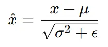

#### Batch Norm

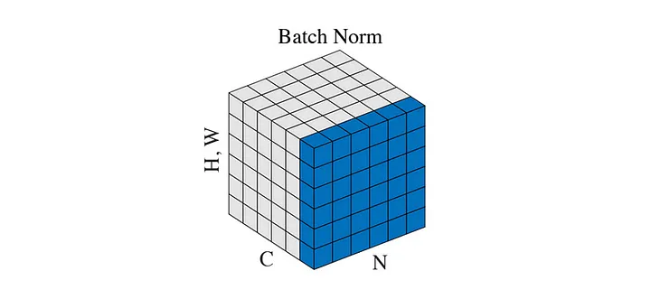

Normalise across the whole batch per channel

```python
def BatchNorm(x, gamma, beta, eps=1e-5):
    # x shape [N, C, H, W]

    mean = torch.mean(x, dim=[0,2,3], keepdim=True)  # [1, C, 1, 1]
    var = torch.var(x, dim=[0,2,3], keepdim=True)    # [1, C, 1, 1]

    x_hat = (x - mean) / torch.sqrt(var + eps)
    
    return gamma * x_hat + beta
```

#### Layer Norm

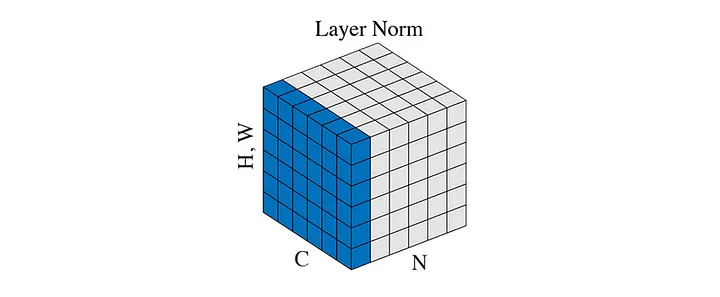

Normalise features of each individual sample in a layer

```python
def LayerNorm(x, gamma, beta, eps=1e-5):
    # x shape [N, C, H, W]
    
    mean = torch.mean(input=x, dim=[1,2,3], keepdim=True) # [N, 1, 1, 1]
    var = torch.var(input=x, dim=[1,2,3], keepdim=True)   # [N, 1, 1, 1]
    
    x_hat = (x - mean) / torch.sqrt(var + eps)
    
    return gamma * x_hat + beta
```

#### Instance Normalisation

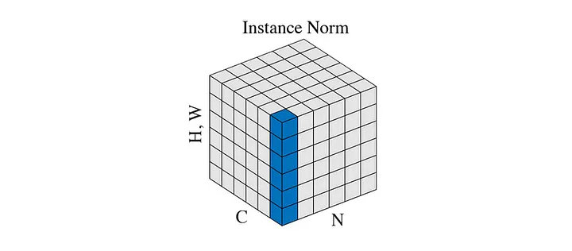

Normalise features of each individual sample in a layer per channel

```python
def InstanceNorm(x, gamma, beta, eps=1e-5):
    # x shape [N, C, H, W]

    mean = torch.mean(input=x, dim=[2,3], keepdim=True)  # [N, C, 1, 1]
    var = torch.var(input=x, dim=[2,3], keepdim=True)    # [N, C, 1, 1]

    x_hat = (x - mean) / torch.sqrt(var + eps)
    
    return gamma * x_hat + beta
```

#### Group Normalisation

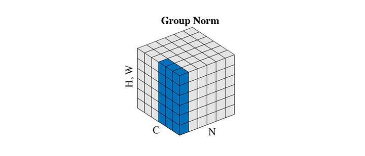

```python
def GroupNorm(x, gamma, beta, group_num, eps=1e-5):
    # x shape [N, C, H, W]

    x = torch.reshape(x, shape=[N, G, C // G, H, W])
    mean = torch.mean(x, dim=[2,3,4], keepdim=True)  # [N, G, 1, 1, 1]
    var = torch.var(x, dim=[2,3,4], keepdim=True)    # [N, G, 1, 1, 1]

    x_hat = (x - mean) / torch.sqrt(var + eps)

    x_hat = torch.reshape(x, shape=[N, C, H, W])
    
    return gamma * x_hat + beta
```


## Types of error

Errors:
- Training error: model error on the training data
- Generalisation error: model error on new data
- Test error: model error on test dataset

Datasets:
- Validation dataset. Used to evaluate model (should not be mixed with training data)
- Test dataset. Should only be used once

K-fold Cross Validation:
- Popular choices for K are 5 or 10
```python
partition training data into K parts

for i in range(K):
    validation_set = part[i]
    training_set = all other parts
    
    train model on training_set
    compute error on validation_set

report average error across K folds
```

## Regularisation Methods

### Constrained Optimisation (Squared Norm Regularisatiion as Hard Constraint)

- $\min \mathcal{l(\mathbf w, b)}$ subject to $||\mathbf w ||^2 \le \theta$
- Often do not include bias as usually has no impact in practice

### L2 Regularisation / Weight decay / Ridge regression / Tikhonov regularisation

- Update loss function to include $\frac{\lambda}{2} ||\mathbf w ||^2$.
- Hyperparameter $\lambda$ controls regularisation importance
- $\lambda \rightarrow \infty, \mathbf w \rightarrow \mathbf0$

Note that changing the loss function will update the weight update equation:
- $\frac{\partial}{\partial \mathbf{w}} \left( \ell(\mathbf{w}, b) + \frac{\lambda}{2} \|\mathbf{w}\|^2 \right) = \frac{\partial \ell(\mathbf{w}, b)}{\partial \mathbf{w}} + \lambda \mathbf{w}$
- $\mathbf{w}_{t+1} = (1 - \eta\lambda)\mathbf{w}_t - \eta \frac{\partial \ell(\mathbf{w}_t, b_t)}{\partial \mathbf{w}_t}$

Compared to our original update equation $w_{t} \leftarrow w_{t-1} - \eta \cdot \frac{\partial \mathcal{L}}{\partial w_{t-1}}$ the weights now decay on each step, so this can also be called **weight decay** (where $\eta \lambda < 1$).

### Dropout

- Dropout is element wise zeroing for neurons in a layer

During training:
- Each neuron is set to zero with probability $p$
- Surviving neurons is scaled up by $\frac{1}{1-p}$
- Usually applied to output of fully connected layers

During inference:
- Turned off completely

## VC dimension

Measure of the capacity (complexity, expressive power) of a binary classification model, defined as the maximum number of data points that can be shattered (perfectly classified) by the model in all possible
configurations.

Applies to binary classifiers.

Example:
- 2d perceptron has 3 parameters (w1, w2, b); can classify 3 points perfectly (not 4) $\rightarrow \text{VC}=3$
- Perceptron with N parameters $\rightarrow \text{VC}=N$
- Some multilayer perceptrons $\rightarrow \text{VC}=N \log_2 (N)$

## Perceptrons

Perceptron defined as:
$$
o = \sigma(\langle \mathbf{w}, \mathbf{x} \rangle + b)
$$

$$
\sigma(x) = \begin{cases} 1 & \text{if } x > 0 \\ 0 & \text{otherwise} \end{cases}
$$

Training the perceptron:
$$
\begin{array}{l}
\textbf{initialize } w = 0 \text{ and } b = 0 \\
\textbf{repeat} \\
\quad \textbf{if } y_i \left[\langle w, x_i \rangle + b\right] \leq 0 \textbf{ then} \\
\quad\quad w \leftarrow w + y_i x_i \text{ and } b \leftarrow b + y_i \\
\quad \textbf{end if} \\
\textbf{until } \text{all classified correctly}
\end{array}
$$
Equivalent to $\mathcal{l}(y, \mathbf x, \mathbf w)= \max(0, -y \langle \mathbf x, \mathbf x \rangle)$

Convergence thereom:
- $x_{ik}w_k + b$ is the raw output from the decision boundary.
- Multiplying by $y_i$ is a sign-correction trick:
    - $y_i = +1$ and output is positive $\rightarrow$ product is positive
    - $y_i = -1$ and output is negative $\rightarrow$ product is positive
- Taking the minimum just picks the closest correctly-classified point to the boundary - which is the tightest constraint on your separator
- So $\rho$ is literally: how much breathing room does the worst-case point have from the decision boundary.


$$
y_i (x_{ik}w_{k} + b) \ge \rho \qquad \text{for all }i : ||w||^2 + b \le 1
$$
Then guaranteed the perceptron will converge after $\frac{r^2+1}{\rho^2}$ steps. Yes that means you need optimal weights to show optimal convergence steps...

Example:
- Take 3 points $([x1, x2], y): ([2,0], +1), ([-3, 1], -1), ([1,5], +1)$
- $\mathbf w = [1,0]$, $b = 0$
- Point 1: $+1 \cdot (2 \cdot 1 + 0 \cdot 0 + 0) = +1 \cdot 2 = 2$
- Point 2: $-1 \cdot (-3 \cdot 1 + 1 \cdot 0 + 0) = -1 \cdot (-3) = 3$
- Point 3: $+1 \cdot (1 \cdot 1 + 5 \cdot 0 + 0) = +1 \cdot 1 = 1$
- $\rho = \min(2,3,1) = 1$

Note on compression:
- When the perceptron trains, it only updates $w$ whenever it makes a mistake
- So the final $w$ is just a sum of the mislabeled $x_i$
- This means you only need to remember which examples caused mistakes, not the whole dataset
- If you made 5 mistakes over 100 examples, you only need to store 5 vectors to fully reconstruct $w$. That's the compression

### Analytic solution to linear regression

$X \leftarrow [X,\bold{1}], w \leftarrow [\bold{w}, b]^\top$

$$
\begin{align}
\partial_{\mathbf{w}}\|\mathbf{y} - \mathbf{Xw}\|^2 = 2\mathbf{X}^\top(\mathbf{Xw} - \mathbf{y}) = 0 \text{ and hence } \mathbf{X}^\top\mathbf{y} = \mathbf{X}^\top\mathbf{Xw} \\

\mathbf{w}^* = (\mathbf{X}^\top\mathbf{X})^{-1}\mathbf{X}^\top\mathbf{y}

\end{align}
$$


# Wk 5 Modern RNNs

## (VGG) 2 3x3 vs 1 5x5 Convolution

- Simonyan and Zisserman (2014) (VGG Creators) showed that deep and narrow networks significantly outperform their shallow counterparts.
- Key insight was showing that stacking multiple 3x3 convs gives:
  - same effective receptive field as a larger kernel (two 3x3s = one 5x5, three 3x3s = one 7x7)
  - but with fewer parameters
  - and more nonlinearities

## (NiN)

Problems with existing models (LeNet, AlexNet, VGG):
- Fully connected layers at the end of the architecture consume tremendous numbers of parameters
- Impossible to add fully connected layers earlier in the network to increase the degree of nonlinearity: doing so would destroy the spatial structure and require potentially even more memory

This is fixed with NiN:
- Applies a fully connected layer at each pixel location (for each height and width). The resulting convolution can be thought of as a fully connected layer acting independently on each pixel location.

They were proposed on a simple insight:
- (i) use convolutions to add local nonlinearities across the channel activations
- (ii) use global average pooling to integrate across all locations in the last representation layer

## GoogLeNet

Clear demarcation between:
- Stem (data ingestion)
- Body (data processing)
- Head (predictions)

Key problem in prior networks was selecting the convolution size for the body. E.g., is $1\times 1$ best or $11\times 11$ best?
- GoogLeNet says use all of them, part of an `inception` block.
- Concatenate all the outputs.


# Architectures

## LeNet

One of the first published CNNs; 1995.

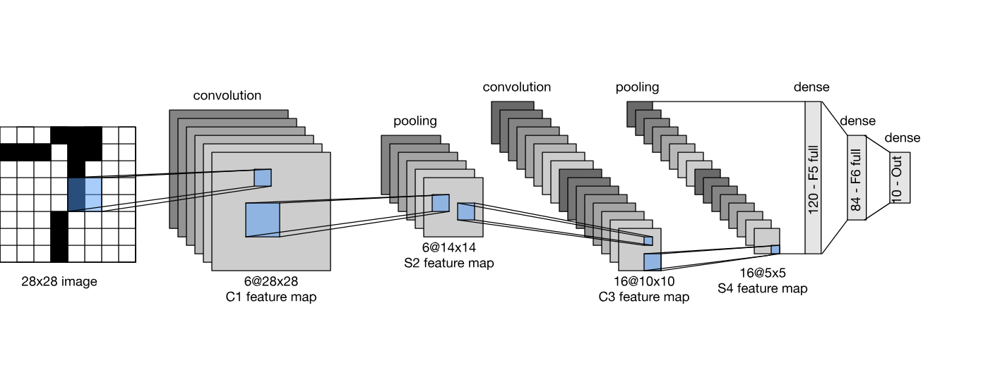

```python
class LeNet(nnx.Module):
    def __init__(self, rngs: nnx.Rngs, image_size=28, num_classes=10):
        self.features = nnx.Sequential(
            nnx.Conv(1, 6, (5, 5), padding="SAME", rngs=rngs),
            nnx.sigmoid,
            AvgPool((2,2), (2,2)),
            nnx.Conv(6, 16, (5, 5), padding="VALID", rngs=rngs),
            nnx.sigmoid,
            AvgPool((2,2), (2,2))
        )

        dummy_data = ShapeDtypeStruct((1, image_size, image_size, 1), jnp.float32)
        dummy_shape = eval_shape(self.features, dummy_data).shape
        flattened_size = prod(dummy_shape[1:])

        self.classifier = nnx.Sequential(
            nnx.Linear(flattened_size, 120, rngs=rngs),
            nnx.sigmoid,
            nnx.Linear(120, 84, rngs=rngs),
            nnx.sigmoid,
            nnx.Linear(84, num_classes, rngs=rngs)
        )

    def __call__(self, x):
        x = self.features(x)
        x = x.reshape(x.shape[0], -1)
        x = self.classifier(x)
        return x
```

## AlexNet

Won the ImageNet Large Scale Visual Recognition Challenge 2012.

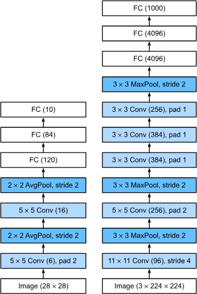

``` python
class AlexNet(nnx.Module):
    def __init__(self, rngs: nnx.Rngs, image_size=224, num_classes=100):
        self.features = nnx.Sequential(
            nnx.Conv(3, 96, (11,11), (4,4), padding=(1,1), rngs=rngs), nnx.relu,
            MaxPool((3,3), (2,2)),
            nnx.Conv(96, 256, (5,5), padding="SAME", rngs=rngs), nnx.relu,
            MaxPool((3,3), (2,2)),
            nnx.Conv(256, 384, (3,3), padding=(1,1), rngs=rngs), nnx.relu,
            nnx.Conv(384, 384, (3,3), padding=(1,1), rngs=rngs), nnx.relu,
            nnx.Conv(384, 256, (3,3), padding=(1,1), rngs=rngs), nnx.relu,
            MaxPool((3,3), (2,2)),
        )

        dummy_data = ShapeDtypeStruct((1, image_size, image_size, 3), jnp.float32)
        dummy_shape = eval_shape(self.features, dummy_data).shape
        flattened_size = prod(dummy_shape[1:])

        self.classifier = nnx.Sequential(
            nnx.Linear(flattened_size, 4096, rngs=rngs), nnx.relu,
            nnx.Dropout(0.5, rngs=rngs),
            nnx.Linear(4096, 4096, rngs=rngs), nnx.relu,
            nnx.Dropout(0.5, rngs=rngs),
            nnx.Linear(4096, num_classes, rngs=rngs)
        )

    def __call__(self, x):
        x = self.features(x)
        x = x.reshape(x.shape[0], -1)
        x = self.classifier(x)
        return x
```

## VGG

The idea of using blocks first emerged from the Visual Geometry Group (VGG) at Oxford University, in their eponymously-named VGG network.

A VGG block is $n$ (3x3 conv, relu) layers each with $k$ out_features followed by $1$ max_pool layer window_size=(2,2), stride=(2,2).

Example arches:

```
format = [(n,k), ...]
vgg11_arch = [(1, 64), (1, 128), (2, 256), (2, 512), (2, 512)]
vgg16_arch = [(2, 64), (2, 128), (3, 256), (3, 512), (3, 512)]
vgg19_arch = [(2, 64), (2, 128), (4, 256), (4, 512), (4, 512)]
```

```python
class VGG_Block(nnx.Module):
    def __init__(self, num_convs, in_channels, out_channels, rngs: nnx.Rngs):
        layers = []
        for i in range(num_convs):
            layers.append(nnx.Conv(in_channels if i == 0 else out_channels, out_channels, kernel_size=(3,3), padding=(1,1), rngs=rngs))
            layers.append(nnx.relu)
        self.layers = nnx.Sequential(*layers, MaxPool((2,2), (2,2)))
    
    def __call__(self, x):
        return self.layers(x)

class VGG(nnx.Module):
    def __init__(self, arch: list[tuple[int,int]], rngs: nnx.Rngs, image_size, in_channels=3, num_classes=10):
        layers = []
        temp_in_channels = in_channels
        for (num_convs, out_channels) in arch:
            layers.append(VGG_Block(num_convs, temp_in_channels, out_channels, rngs=rngs))
            temp_in_channels = out_channels
        
        self.features = nnx.Sequential(*layers)
        
        dummy_data = ShapeDtypeStruct((1, image_size, image_size, in_channels), jnp.float32)
        dummy_shape = eval_shape(self.features, dummy_data).shape
        flattened_size = prod(dummy_shape[1:])

        self.classifier = nnx.Sequential(
            nnx.Linear(flattened_size, 4096, rngs=rngs), nnx.relu,
            nnx.Dropout(0.5, rngs=rngs),
            nnx.Linear(4096, 4096, rngs=rngs), nnx.relu,
            nnx.Dropout(0.5, rngs=rngs),
            nnx.Linear(4096, num_classes, rngs=rngs)
        )

    def __call__(self, x: jnp.ndarray):
        x = self.features(x)
        x = x.reshape(x.shape[0], -1)
        x = self.classifier(x)
        return x
```

## NiN

```python
class NiN_Block(nnx.Module):
    def __init__(self, in_features, out_features, kernel_size, strides, rngs: nnx.Rngs, padding:PaddingLike = "VALID"):
        self.layers = nnx.Sequential(
            nnx.Conv(in_features, out_features, kernel_size=kernel_size, strides=strides, padding=padding, rngs=rngs),
            nnx.relu,
            nnx.Conv(out_features, out_features, (1,1), rngs=rngs),
            nnx.relu,
            nnx.Conv(out_features, out_features, (1,1), rngs=rngs),
            nnx.relu
        )

    def __call__(self, x):
        return self.layers(x)

class NiN(nnx.Module):
    def __init__(self, rngs: nnx.Rngs, num_classes=10):
        self.layers = nnx.Sequential(
            NiN_Block(3, 96, (11,11), (4,4), rngs=rngs),
            MaxPool((3,3), (2,2)),
            NiN_Block(96, 256, (5,5), (1,1), rngs=rngs, padding="SAME"),
            MaxPool((3,3), (2,2)),
            NiN_Block(256, 384, (3,3), (1,1), rngs=rngs, padding="SAME"),
            MaxPool((3,3), (2,2)),
            nnx.Dropout(0.5, rngs=rngs),
            NiN_Block(384, num_classes, (3,3), (1,1), rngs=rngs, padding="SAME"),
        )

    def __call__(self, x: jnp.ndarray):
        x = self.layers(x)
        x = x.mean(axis=(1,2)) # NHWC; C=10
        return x
```

## GoogLeNet

From d2l.ai:

> As depicted in Fig. 8.4.1, the inception block consists of four parallel branches. The first three branches use convolutional layers with window sizes of , , and to extract information from different spatial sizes. The middle two branches also add a convolution of the input to reduce the number of channels, reducing the model’s complexity. The fourth branch uses a max-pooling layer, followed by a convolutional layer to change the number of channels. The four branches all use appropriate padding to give the input and output the same height and width. Finally, the outputs along each branch are concatenated along the channel dimension and comprise the block’s output. The commonly-tuned hyperparameters of the Inception block are the number of output channels per layer, i.e., how to allocate capacity among convolutions of different size.

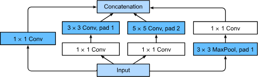

## Batch Normalisation

Also described under normalisation in [prior notes](./wk1-4_basics.md)

For a given `NHWC`

| Type | Reduces | Independent |
|---|---|---|
| Batch | `NHW` | `C` |
| Layer | `HWC` | `N` |
| Instance | `HW` | `NC` |
| Group | `HW(C/G)` | `NG` |

How to remember:
- Batch norm operates before - NHW are reduced, C is independent
- Layer norm operates later - HWC are reduced, N is independent
- Instance norm operates inside - HW are reduced, N and C are independent
- Group norm groups instances by C - HWC are reduced, N and C are independent


# Wk 6 Recurrent Neural Networks

## Coming From Non-Sequential Data

Previously we assumed data was sampled from some $P(X)$. We still assume that the entire sequence is sampled independently. Tokens within a sequence are not assumed to be independent.

## Sequence Modelling

### Intro

I.e., to estimate the probability mass function that tells us how likely we are to see any given sequence $p(\mathbf{x}_1, \dots, \mathbf{x}_T$).

Note while we may be interested in the probability distribution $P(x_t \mid x_{t-1}, \dots, x_1)$, this can be difficult. We may try $\mathbf{E}[(x_t \mid x_{t-1}, \dots, x_1)]$ instead.

Trying to regress the value of a signal based on previous values of the same signal is an autoregressive model. In sequential data, we often need strategies to handle sequences of varying length. Strategies may include:
1. Condition only on some window of length $\tau$ and only use $x_{t-1}, \dots, x_{t-\tau}$ observations. This would allow us to use any linear model or deep network that requires fixed-lenght inputs as features.
2. Develop a model that maintains some summary $h_t$ of past observations and at the same time update $h_t$ in addition to $\hat{x}_t$. This would give us a model that estimates $x_t$ with $\hat{x}_t = P(x_t \mid h_t)$ and updates $h_t = g(h_{t-1}, x_{t-1})$. As $h_t$ is an internal hidden state, this is called a latent autoregressive model.

When we take a long historical sequence and cut it into many smaller training examples, we make the assumption that while actual values can change over time, the dynamics according to which each subsequent observation is generated given the previous observations do not. Dynamics that do not change are called stationary.

### Sequence Models

When we wish to estimate the joint probability of an entire sequence (and for language data they are called language models).

How is this an autoregressive problem? Consider:

$$
P(x_1, \dots, x_T) = P(x_1) \prod^T_{t=2} P(x_t \mid x_{t-1}, \dots, x_1)
$$

Let 
$$x_1 = \text{The}, \quad x_2 = \text{cat}, \quad x_3 = \text{slept}$$

The probability of the whole sequence is:
$$P(\text{The, cat, slept})$$

Using the chain rule:
$$
P(x_1, x_2, x_3) = P(x_1)P(x_2 \mid x_1)P(x_3 \mid x_1, x_2)
$$

So:
$$
P(\text{The cat slept}) =
P(\text{The})
\times
P(\text{cat} \mid \text{The})
\times
P(\text{slept} \mid \text{The cat})
$$

Therefore modelling the joint probability of a whole sequence can be rewritten as modelling a series of next-token probabilities.

### Markov Models

A Markov model assumes that the future only depends on a fixed number of recent previous timesteps, not the entire history.

For a window length $\tau$, we predict $x_t$ using only $x_{t-1}, \dots, x_{t-\tau}$ rather than the full history $x_{t-1}, \dots, x_1$.

This is the Markov condition:

$$ P(x_t \mid x_{t-1}, \dots, x_1) =
P(x_t \mid x_{t-1}, \dots, x_{t-\tau})
$$

I.e., once we know the recent history, the older history provides no additional predictive information.

If $\tau = 1$, this is a first-order Markov model. The next token only depends on the previous token:

$$ P(x_1, \dots, x_T) =
P(x_1)\prod_{t=2}^{T}P(x_t \mid x_{t-1})
$$

If $\tau = k$, this is a $k^\text{th}$-order Markov model. The next token depends on the previous $k$ tokens.

This assumption is often only approximately true. In real language, earlier context can still matter, but the benefit of adding more past context usually diminishes.

Markov models are useful because they reduce the computational problem from:

$$
P(x_t \mid x_{t-1}, \dots, x_1)
$$

to something shorter and fixed-length:

$$
P(x_t \mid x_{t-1}, \dots, x_{t-k})
$$

For discrete data like language, a simple Markov model can estimate probabilities by counting how often each token occurs after each context. This is basically an $n$-gram style model.

### Converting Raw Text into Sequence Data

Tokens are indivisible units of text. Each timestep corresponds to 1 token.

Breaking text into tokens usually includes:
1. Split/encode text into tokens/subwords/characters/words (e.g., unigram, wordpiece, bytepair)
2. A vocab associates each distinct token value with a unique index (the vocabulary is the fixed list/set of all allowed token types, usually with IDs).
3. Map IDs to vectors

Usually tokenisation refers to steps 1 and 2. Embedding refers to step 3.

Embedding associates each unique index with a vector of $\mathbb{R}^d$ where $d$ is the embedding dimension.

The embedding dimension, also called embedding size, hidden size, model dimension, or $d_{\text{model}}$, is the length of the vector used to represent each token.

## Language Models

$$
P(x_1, x_2, \ldots, x_T) = \prod_{t=1}^T P(x_t  \mid  x_1, \ldots, x_{t-1}).
$$

For ex:

$$
\begin{split}\begin{aligned}&P(\textrm{deep}, \textrm{learning}, \textrm{is}, \textrm{fun}) \\
=&P(\textrm{deep}) P(\textrm{learning}  \mid  \textrm{deep}) P(\textrm{is}  \mid  \textrm{deep}, \textrm{learning}) P(\textrm{fun}  \mid  \textrm{deep}, \textrm{learning}, \textrm{is}).\end{aligned}\end{split}
$$

### Markov Models

We can model the joint probability as a unigram, bigram or trigam:

$$
\begin{split}\begin{aligned}
P(x_1, x_2, x_3, x_4) &=  P(x_1) P(x_2) P(x_3) P(x_4),\\
P(x_1, x_2, x_3, x_4) &=  P(x_1) P(x_2  \mid  x_1) P(x_3  \mid  x_2) P(x_4  \mid  x_3),\\
P(x_1, x_2, x_3, x_4) &=  P(x_1) P(x_2  \mid  x_1) P(x_3  \mid  x_1, x_2) P(x_4  \mid  x_2, x_3).
\end{aligned}\end{split}
$$

### Word Frequency

We might attempt to estimate:

$$
\hat{P}(\textrm{learning} \mid \textrm{deep}) = \frac{n(\textrm{deep, learning})}{n(\textrm{deep})},
$$

For some feasible word pairs or triplets, they may never occur in the training corpus and thus cannot be predicted unless other measures are taken (Laplace smoothing).

Laplace smoothing. Add some small constant to all counts:

$$
\begin{split}\begin{aligned}
    \hat{P}(x) & = \frac{n(x) + \epsilon_1/m}{n + \epsilon_1}, \\
    \hat{P}(x' \mid x) & = \frac{n(x, x') + \epsilon_2 \hat{P}(x')}{n(x) + \epsilon_2}, \\
    \hat{P}(x'' \mid x,x') & = \frac{n(x, x',x'') + \epsilon_3 \hat{P}(x'')}{n(x, x') + \epsilon_3}.
\end{aligned}\end{split}
$$

Why this strategy fails:

1. Data sparsity: many n-grams are rare or never seen, especially long sequences, so count-based probabilities are unreliable.
2. Storage problem: the model must store huge numbers of n-gram counts.
3. No semantic understanding: it treats words as unrelated symbols, so it does not know that words like “cat” and “feline” are related.

## Perplexity

We need some way of comparing loss between variable length sequences. This is defined as perplexity:

Let $x_{<t} = x_1, \dots, x_{t-1}$ and $V$ be all possible tokens.

$$
\text{Perplexity} = \exp\left(- \frac{1}{n} \sum_{t=1}^n \sum_{v \in V} P(v \mid x_{<t}) \cdot \ln \hat{P}(v \mid x_{<t}) \right)
$$

Which when one-hot encoded:

$$
\text{Perplexity} = \exp\left(- \frac{1}{n} \sum_{t=1}^n\cdot \ln \hat{P}(x_t \mid x_{<t}) \right)
$$

## Partitioning

Let $T$ be sequence length, we will partition into subsequences of length $n$.

To introduce randomness, for each epoch, discard the first $d \in [0, n)$ tokens uniformaly sampled at random.

We will then have $m = \lfloor \frac{T - d}{n} \rfloor$ subsequences where $\mathbf x_t = [x_t, \dots, x_{t+n-1}]$. 

Then, when we randomly sample for the minibatch we will randomly select an $\mathbf x_t$ where:

$$
t = d + Kn, \qquad K \sim \text{Uniform}\{ 0, 1, \dots, m-1 \}
$$

For ex for $n=5$ and $d=2$:

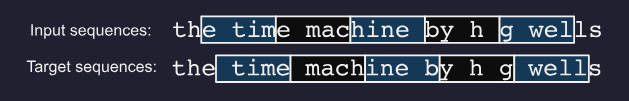

## Shortcomings of MLP

- Non-variable input sequence length
- Rules learned for first few tokens do not generalise to other tokens as the weights are different

## Koren 2009

Showed selection bias for older movie ratings. Older movies are more likely to be sought out by viewers, and they resultant rating is likely better.

Also showed that when netflix changed their rating system, mean scores of movies significantly.

## Problems with Markov Models / n-grams

TODO

## Training

Gradient clipping and truncated backpropagation through time required to aid convergence.

In an RNN, the same hidden-to-hidden weights are used at every time step. When you backpropagate, the gradient to early time steps is found by multiplying through many time steps in a row (repeated multiplication by the same kinds of terms).

Causes 2 problems:
1. Vanishing gradient

    If terms less than 1 in magnitude, values shrink towards 0. Early timesteps get almost no learning signal. RNN fails to learn long-range dependencies.

    Solutions:
    - (LSTM) Add a separate memory 
      - The cell state has a direct carry path
      - If the forget gate is close to 1, the old cell state is mostly preserved
      - Because of that, the backward gradient through that path is also mostly preserved
    - Create more direct and linear pass-through connections: attention, residual connections

2. Exploding gradient

    Gradient clipping.

## Recurrent Neural Networks with Hidden States

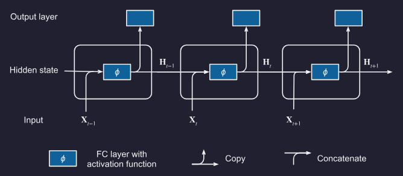

Lets define our minibatch $X$ as $X \in \mathbb{R}^{n\times T\times d}$ where $n$ is example number, $T$ is timestep and $d$ is feature length for time step.

We also define a timestep slice as $X_t = X[:, t, :] \in \mathbb{R}^{n\times d}$.

We define our outputs:
- $H_t \in \mathbb{R}^{n\times h}$ is the hidden layer output at t.

We define our weights:
- $W_{hh}$ is a mapping from prev hidden layer (h) ($t-1$ to $t$)
- $W_{xh}$ is a mapping from x
- $W_{hq}$ is a mapping from a latent form to an output

Then our hidden layer output is:

$$
H_t = \phi(X_t W_{xh} + H_{t-1} W_{hh} + b_h)
$$

For time step $t$, our output layer is:

$$
O_t = H_t W_{hq} + b_q
$$

Since the hidden state uses the same definition of the previous time step in the current time step, the computation is recurrent. Note also the same parameters are reused at every timestep. Therefore, the parametrization cost of an RNN does not grow as the number of time steps increases.

Torch implementation:

```python
class RNNClassifier(nn.Module):
    def __init__(self, vocab_size, embed_dim, hidden_dim, output_dim):
        super().__init__()

        self.hidden_dim = hidden_dim

        self.embedding = nn.Parameter(torch.normal(0, 1, size=(vocab_size, embed_dim)))
        self.hh = nn.Linear(in_features=hidden_dim, out_features=hidden_dim)
        self.xh = nn.Linear(in_features=embed_dim, out_features=hidden_dim)
        self.a = nn.ReLU()
        self.o = nn.Linear(in_features=hidden_dim, out_features=output_dim)

    def forward(self, x: torch.Tensor):
        x = self.embedding[x] # n, t, embed_dim
        latent = torch.zeros(x.shape[0], self.hidden_dim, device=x.device)
        for i in range(x.shape[1]):
            h = self.hh(latent)
            k = self.xh(x[:, i, :])
            latent = self.a(h + k)

        return self.o(latent)
```

At as simple level, $x$ and $h_{t-1}$ are both mapped into a hidden-state space, added together and passed through an activation function

## Weight matrix concatenation

It is possible to concatenate $X \And H$ and $W_{xh} \And W_{hh}$:

```python
X, W_xh = torch.randn(3, 1), torch.randn(1, 4)
H, W_hh = torch.randn(3, 4), torch.randn(4, 4)

A = torch.cat((X, H), 1) # (3, 5)
B = torch.cat((W_xh, W_hh) # (5, 4)
torch.matmul(A, B, 0))
## is equivalent to
torch.matmul(X, W_xh) + torch.matmul(H, W_hh)
```

## LSTM

### Plain

Conceptually contains 2 gate layers to modify cell state:
- $f_t = \sigma(W_f \cdot [h_{t-1}, x_t] + b_f)$ (forget gate)

- $i_t = \sigma(W_i \cdot [h_{t-1}, x_t] + b_i)$ (between 0 and 1, what parts of candidate to use) (input gate)

- $\tilde{C}_t = \tanh(W_C \cdot [h_{t-1}, x_t] + b_C)$ (candidate cell state)

- $C_t = f_t \odot C_{t-1} + i_t \odot \tilde{C}_t$

To generate our new latent:
- $o_t = \sigma (W_o [h_{t-1}, x_t] + b_o)$ (output gate)
- $h_t = o_t \odot \tanh(C_t)$

We can then throw our latent into a linear layer or whatnot to generate classifications or predictions.

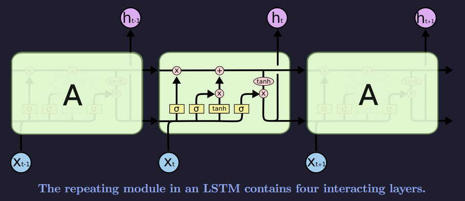

### GRU

GRU merges cell state and hidden state into a single hidden state \(h_t\).

- $z_t = \sigma(W_z [h_{t-1}, x_t])$ (update gate)
  
  weight new hidden state vs old hidden state

- $r_t = \sigma(W_r [h_{t-1}, x_t])$ (reset gate)

  decides how much of the previous hidden state to use when forming the candidate

- $\tilde{h}_t = \tanh(W [r_t \odot h_{t-1}, x_t])$ (candidate hidden state)

- $h_t = (1-z_t)\odot h_{t-1} + z_t \odot \tilde{h}_t$ (hidden state update)

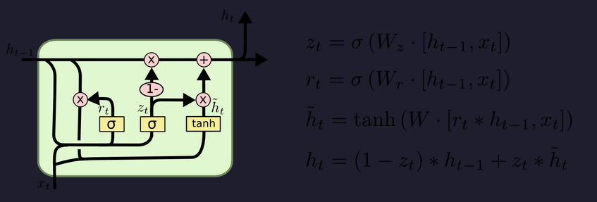

## Deep RNN

To make a deep RNN we simply stack layers on top of each other:

Lets define our minibatch $X$ as $X \in \mathbb{R}^{n\times T\times d}$ where $n$ is example number, $T$ is timestep and $d$ is feature length for time step.

We also define a timestep slice as $X_t = X[:, t, :] \in \mathbb{R}^{n\times d}$. At the same timestep, let's define the hidden state of the $l^\textrm{th}$ hidden layer ($l=1, \dots, L$) to be $H_t^{(l)}$. Also $O_t \in \mathbb{R}^{n\times q}$ ($q$ outputs), $H_t^{(0)}=X_t$. Then the hidden state of the $l^\textrm{th}$ hidden layer with activation function $\phi_l$ is:

$$
\mathbf{H}_t^{(l)} = \phi_l(\mathbf{H}_t^{(l-1)} \mathbf{W}_{\textrm{xh}}^{(l)} + \mathbf{H}_{t-1}^{(l)} \mathbf{W}_{\textrm{hh}}^{(l)}  + \mathbf{b}_\textrm{h}^{(l)}),
$$

Where $\mathbf{W}_{\textrm{xh}}^{(l)} \in \mathbb{R}^{h \times h}$, $\mathbf{W}_{\textrm{hh}}^{(l)} \in \mathbb{R}^{h \times h}$ and $\mathbf{b}_\textrm{h}^{(l)} \in \mathbb{R}^{1 \times h}$.

Output computed by:

$$
\mathbf{O}_t = \mathbf{H}_t^{(L)} \mathbf{W}_{\textrm{hq}} + \mathbf{b}_\textrm{q}
$$

Hyperparameters:
- $L$ hidden layers (usually $[1,8]$)
- $h$ hidden units (size of the hidden state vector at each time step) (model dimension) (usually $[64, 2056]$)

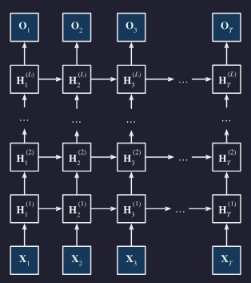

## Bidirectional RNN

We simply add another layer and run it in the reverse direction.

Lets define our minibatch $X$ as $X \in \mathbb{R}^{n\times T\times d}$ where $n$ is example number, $T$ is timestep and $d$ is feature length for each timestep.

We also define a timestep slice as $X_t = X[:, t, :] \in \mathbb{R}^{n\times d}$.

At timestep $t$, let:
- $\overrightarrow{H}_t \in \mathbb{R}^{n\times h}$ be the **forward** hidden state
- $\overleftarrow{H}_t \in \mathbb{R}^{n\times h}$ be the **backward** hidden state

Then with hidden activation function $\phi$, the hidden states are:

$$ \overrightarrow{\mathbf{H}}_t =
\phi\!\left(
\mathbf{X}_t \mathbf{W}_{\mathrm{xh}}^{(f)}
+
\overrightarrow{\mathbf{H}}_{t-1}\mathbf{W}_{\mathrm{hh}}^{(f)}
+
\mathbf{b}_{\mathrm{h}}^{(f)}
\right)
$$

$$ \overleftarrow{\mathbf{H}}_t =
\phi\!\left(
\mathbf{X}_t \mathbf{W}_{\mathrm{xh}}^{(b)}
+
\overleftarrow{\mathbf{H}}_{t+1}\mathbf{W}_{\mathrm{hh}}^{(b)}
+
\mathbf{b}_{\mathrm{h}}^{(b)}
\right)
$$

Where $\mathbf{W}_{\mathrm{xh}}^{(f)} \in \mathbb{R}^{d\times h}$, $\mathbf{W}_{\mathrm{hh}}^{(f)} \in \mathbb{R}^{h\times h}$, $\mathbf{W}_{\mathrm{xh}}^{(b)} \in \mathbb{R}^{d\times h}$, $\mathbf{W}_{\mathrm{hh}}^{(b)} \in \mathbb{R}^{h\times h}$, $\mathbf{b}_{\mathrm{h}}^{(f)} \in \mathbb{R}^{1\times h}$, $\mathbf{b}_{\mathrm{h}}^{(b)} \in \mathbb{R}^{1\times h}$.

We then concatenate the forward and backward hidden states:

$$
\mathbf{H}_t = [\overrightarrow{\mathbf{H}}_t,\overleftarrow{\mathbf{H}}_t] \in \mathbb{R}^{n\times 2h}
$$

This concatenated hidden state is then used to compute the output:

$$
\mathbf{O}_t = \mathbf{H}_t \mathbf{W}_{\mathrm{hq}} + \mathbf{b}_{\mathrm{q}}
$$

Where $\mathbf{O}_t \in \mathbb{R}^{n\times q}$, $\mathbf{W}_{\mathrm{hq}} \in \mathbb{R}^{2h\times q}$, $\mathbf{b}_{\mathrm{q}} \in \mathbb{R}^{1\times q}$.

Hyperparameters:
- $h$ hidden units in each direction
- $q$ output size

Key idea:
- the forward state captures **past context**
- the backward state captures **future context**
- concatenating them gives each timestep access to information from **both sides**

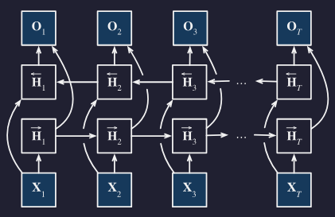


## Sequence to Sequence Modelling

### Encoder Decoder Architecture

Basically encoder computes some context variable $c$.

The decoder is then seeded with the context variable $c$ and recurrently generates the target sequence.

At each decoder step, the input token is either:
- **Inference:** the decoder’s own previous prediction
- **Training with teacher forcing:** the true previous target token

Note an encoder may produce hidden states $h_1, \dots, h_T$ which are compressed into a **context variable** $c$ via a function $q$:

$$
c = q(h_1, \dots, h_T)
$$

For a simple seq2seq RNN: $c = h_T$

For attention seq2seq RNN: $c = [h_1, \dots, h_T]$


### Teacher Forcing

Regardless of prior decoder output, just use the target sequence as part of input sequence:

- Input: `<bos> je suis étudiant` (shift label by inserting `<bos>`)
- Label: `je suis étudiant <eos>`

The decoder uses its previous hidden state, but the next input token is the true target token, not the token it predicted.

### Sequence to Sequence RNN Encoder-Decoder Model

Two general architectures for state handling:

1. Encoder state only seeds decoder

```
c = encoder final hidden state
h0 = c

output1, h1 = DecoderCell(y0, h0)
output2, h2 = DecoderCell(y1, h1)
output3, h3 = DecoderCell(y2, h2)
```

2. Encoder state is fed at every decoder step

```
c = encoder final hidden state
h0 = initial decoder hidden state

output1, h1 = DecoderCell([y0, c], h0)
output2, h2 = DecoderCell([y1, c], h1)
output3, h3 = DecoderCell([y2, c], h2)
```

### Multi-layer Sequence to Sequence RNN Encoder-Decoder Model

For a multi-layer encoder, the context variable may include the final hidden state from each encoder layer:

$$
c = [h_T^{(1)}, h_T^{(2)}, \dots, h_T^{(L)}]
$$

where \(L\) is the number of RNN layers. `c.shape = (num_layers, batch_size, hidden_size)`

Usually decoder layer (l) gets encoder layer (l)’s final state.

So if the encoder context stack is:

$$
C = [h_T^{(1)}, h_T^{(2)}, \dots, h_T^{(L)}]
$$

then the decoder is initialised like:

$$
h_{dec,0}^{(1)} = h_{enc,T}^{(1)}
$$

$$
h_{dec,0}^{(2)} = h_{enc,T}^{(2)}
$$

$$
\vdots
$$

$$
h_{dec,0}^{(L)} = h_{enc,T}^{(L)}
$$

For an LSTM, same idea but with both hidden and cell states:

$$
(h_{dec,0}^{(l)}, c_{dec,0}^{(l)}) = (h_{enc,T}^{(l)}, c_{enc,T}^{(l)})
$$

Important nuance: this assumes encoder and decoder have the **same number of layers and compatible hidden sizes**. If not, people often use a learned projection/bridge $H_{dec,0} = W H_{enc,T}$

So:

```text
Encoder layer 1 final state → Decoder layer 1 initial state
Encoder layer 2 final state → Decoder layer 2 initial state
Encoder layer 3 final state → Decoder layer 3 initial state
```

Two general architectures for state handling:

1. Multi-layer encoder state only seeds multi-layer decoder

```text
c = encoder final hidden states from all layers
h0 = c

output1, h1 = DecoderRNN(y0, h0)
output2, h2 = DecoderRNN(y1, h1)
output3, h3 = DecoderRNN(y2, h2)
```

Here:

```text
h0 = [h0_layer1, h0_layer2, ..., h0_layerL]
```

Each decoder layer is initialised using the corresponding encoder layer’s final hidden state.

2. Multi-layer encoder state is fed at every decoder step

```text
c = encoder final hidden states from all layers
h0 = initial decoder hidden states

output1, h1 = DecoderRNN([y0, c], h0)
output2, h2 = DecoderRNN([y1, c], h1)
output3, h3 = DecoderRNN([y2, c], h2)
```

Here, \(c\) is repeatedly supplied as extra context, while \(h_t\) is the decoder’s evolving multi-layer hidden state.

For an LSTM, the decoder state usually includes both hidden and cell states:

```text
state = (h, cell)
```

so the encoder context may be:

```text
c = (h_n, cell_n)
```

## Evaluation of Predicted Sequence

Analogous to "accuracy" for CNNs, Bilingual Evaluation Understudy (BLEU) is a metric for measuring output sequences quality.

In principle, for any $n$-gram in a predicted sequence, BLEU evaluates whether it appears in the target sequence.

$p_n$ (precision of an $n$-gram) is the ratio of the count of $n$-grams in the prediction appearing in the target to the $n$-grams in the predicted sequence.

$$
p_n = \frac{\text{clipped count of matched n-grams in the prediction}}{\text{n-grams in the prediction}}
$$

For example:
- Target: `A B C D E F`
- Prediction: `A B B C D`
- $p_1 = 4/5$, $p_2 = 3/4$, $p_3 = 1/3$, $p_4 = 0$.

Clipped means a predicted n-gram can only be counted up to the number of times it appears in the target

For example:
- Target: `the cat sat on the mat`
- Prediction: `the the the the`
- For the unigram `the`, the clipped count is 2.

Then the BLEU is defined as:

$$
\text{BLEU} = \exp\left(\min\left(0, 1 - \frac{\textrm{len}_{\textrm{label}}}{\textrm{len}_{\textrm{pred}}}\right)\right) \prod_{n=1}^k p_n^{1/2^n},
$$

Note since $p \in [0,1]$ then $p^{1/n} \le p^{1/2n}$

ANKI NOTES UP TO HERE
---
---
---

## Search Strategies

Denote at any timestep 
- $\mathcal{Y}$ as output vocabulary (including `<eos>`)
- $T'$ as max number of output tokens

Then the goal is to select an ideal sequence from $\mathcal{O}(\left|\mathcal{Y}\right|^{T'})$ possible sequences.

### Greedy Search

$$
y_{t'} = \argmax_{y\in \mathcal{Y}} P(y \mid y, y_1, \dots, y_{t'-1}, c)
$$

### Exhaustive Search

Lol

### Sequence Decoding Beam Search

Just to contrast against A*:

- A*-style search has a global frontier across depths, that is, the frontier can contain nodes at different depths, because the score is intended to make them comparable ($f(n) = g(n) + h(n)$)
- We don't have a $h(n)$ for next token predictions (unless we train something like a value network)
- And raw sequence probability degrades with length $P(y_1, y_2, y_3) \le P(y_1, y_2) \lt P(y_1)$

For sequence decoding beam search, we do a level-synchronous version:
```
t = 1: keep best k sequences of length 1
t = 2: expand those, keep best k sequences of length 2
t = 3: expand those, keep best k sequences of length 3
```
This way all candidates have the same length.

Pseudocode:

```python
frontier = [("", score=0)]

for each timestep:
    candidates = []

    for sequence in frontier:
        expand sequence by every possible next token
        score each new sequence by cumulative log probability
        add to candidates

    frontier = top k candidates
```

Since we stop generating when we get a `<eos>` token, we need a way to compare sequences of different length. Usually this means **length-normalised log probability**.

$$
score(y) = \frac{1}{T} \sum^T_{t=1} \log P(y_t \mid y_{<t},c)
$$

Which is equivalent to perplexity, just wthout the $\exp(-x)$ transformation...

$$
\text{Perplexity} = \exp\left(- \frac{1}{T} \sum^T_{t=1} \log P(y_t \mid y_{<t},c) \right)
$$


# Wk 6.1 Embeddings

## What we actually do

Old setup: `word → pretrained GloVe vector → downstream model`

New setup: `text → subword tokeniser → learned subword embeddings → Transformer` (used by all pre-trained models) (subword representations randomly initialised and learned in the transformer model)

Tokenisation today uses subword tokenisation with tuned vocabulary (usually 50k to 250k pieces, larger for multilingual models)
- Subword tokenisation is better able to handle rare words and new words (e.g., "unicorn" may be tokenised as "uni" + "corn")
- More efficient than character-level tokenisation
- (something something wordpieces are more generalisable to new text compared to words)

Space handling is dependent on the tokeniser. E.g., BERT uses WordPiece tokeniser which adds a special character to indicate that a token is not at the start of a word (e.g., "unicorn" → "uni" + "##corn"). GPT uses Byte Pair Encoding (BPE), elaborated below.

Random note:
- Translation: preserve meaning
- Transliteration: preserve sound

## Byte Pair Encoding (BPE)

Two styles:
1. Treats spaces as normal characters (e.g., may get "hello world" → "hello" + " world")
2. Split on space and add a end of word token (e.g., may get "hello world" → "hello</w>" + "world</w>")

Algorithm
1. Count all adjacent symbol pairs across the entire corpus
2. Find the most frequent pair (e.g., l o)
3. Merge that pair into a single new symbol (e.g., lo)
4. Add the new symbol to the vocabulary
5. Repeat until the vocab reaches a predefined size

So overall
- Frequent words end up as single tokens; rare words broken into subword pieces
- Out of vocab words can be represented by falling back on smaller subword units
- Vocab size is a hyperparameter that is set in advance (e.g., 32000)
- Learned rules are applied determinstically at inference time to new text
- Naturally capturs morphological structure (prefixes, suffixes e.g., un, ing, er)

## Embeddings

In general an LLM or RNN can learn its own embeddings. However it is possible to use pretrained word embeddings.

These methods include:
- Word2Vec
- GloVe
- Elmo
- BERT

Moving from **Word2Vec/Glove** to **Elmo**:
- Word2Vec/Glove: static word embeddings, each word has a single embedding regardless of context
- Elmo: contextual word embeddings, each word has a different embedding depending on the context it

Note using these pretrained embeddings is a form of self-supervised pretraining.

We may start with a large unannotated dataset, use these self-supervised methods to learn embeddings, then apply it to a model with small hand-annotated data.

Note, we don't have to use these fancy schmancy systems. GPT uses a learned embedding layer (with added position information) so effectively the contextual embeddings are produced inside the Transformer itself.

## Word2Vec

- Uses shallow neural network to learn word associations
- Two architectures:
  - Continuous Bag of Words (CBOW) (predict a target word from its surrounding context words)
  - Skip-Gram (predict surrounding context words from a single given target)

In a nutshell:

We have a dataset like `shall I compare thee to a summers day thou art more lovel`, we create a dataset like:
- `(x, y)`
- `(compare, shall)`,
- `(compare, I)`,
- `(compare, thee)`,
- `(compare, to)`,
- `(thee, I)`,
- `(thee, compare)`,
- `(thee, to)`,
- `(thee, a)`,
- ...

Then we train a model to predict y given x.

```python
class SkipGramFullSoftmax(nnx.Module):
    def __init__(self, vocab_size: int, emb_dim: int, *, rngs: nnx.Rngs):
        self.embed = nnx.Embed(
            num_embeddings=vocab_size,
            features=emb_dim,
            rngs=rngs,
        )

        self.output = nnx.Linear(
            in_features=emb_dim,
            out_features=vocab_size,
            use_bias=False,
            rngs=rngs,
        )

    def __call__(self, centre_ids, context_ids):
        # centre_ids: [B]
        # context_ids: [B]

        h = self.embed(centre_ids)      # [B, D]
        logits = self.output(h)         # [B, V]

        loss = optax.softmax_cross_entropy_with_integer_labels(
            logits=logits,
            labels=context_ids,
        ).mean()

        return loss
```

However in the above code we compute the probability of every token in the output which is expensive. Instead we can use negative sampling to only compute the probability of a few negative samples and one positive sample.

In the prior code we had the transform:
- (B, V) → (B, D) → (B, V)

Since the inputs and outputs are one-hot encoded, this is effectively the same as a lookup in a weight matrix. Therefore we can replace the linear layer with an embedding layer.

```python
class SkipGramNegativeSampling(nnx.Module):
    def __init__(self, vocab_size: int, emb_dim: int, *, rngs: nnx.Rngs):
        self.in_embed = nnx.Embed(
            num_embeddings=vocab_size,
            features=emb_dim,
            rngs=rngs,
        )

        self.out_embed = nnx.Embed(
            num_embeddings=vocab_size,
            features=emb_dim,
            rngs=rngs,
        )

    def __call__(self, centre_ids, pos_context_ids, neg_context_ids):
        # centre_ids: [B]
        # pos_context_ids: [B]
        # neg_context_ids: [B, K]

        centre = self.in_embed(centre_ids)            # [B, D]
        pos = self.out_embed(pos_context_ids)         # [B, D]
        neg = self.out_embed(neg_context_ids)         # [B, K, D]

        # Real context score
        pos_logits = jnp.sum(centre * pos, axis=-1)   # [B]

        # Negative context scores
        neg_logits = jnp.einsum("bd,bkd->bk", centre, neg)  # [B, K]

        loss = -(
            jax.nn.log_sigmoid(pos_logits)
            + jnp.sum(jax.nn.log_sigmoid(-neg_logits), axis=-1)
        ).mean()

        return loss
```

## GloVe

- Unsupervised
- Trains very fast
- Uses local sliding context window to learn relationships (the word is defined by the company it keeps)

## ELMo

- Uses character-based word representations
- CNN to learn 512-dim word embedding from characters
- Bidirectional LSTM (not Seq2Seq) to learn contextual word representations
- Pre-trained as a language model

For the $k$-th word in the sequence:
- $h_k^{\text{init}}$ is the non-contextual embedding, generated by the character-based CNN
- $h_{k,y}^{\text{forward}}$ is the forward LSTM output
- $h_{k,y}^{\text{backward}}$ is the backward LSTM output

$e_k$ will be the final embedding for the $k$-th word
- Effectively a weighted sum of the three components
- $\gamma^i$, $\gamma$, $f_j$, $b_j$ are learned

$$ \mathbf e_k =
\gamma^{i}\mathbf h^{\text{init}}_k
+
\gamma \sum_{j=0}^{L} f_j \mathbf h^{\text{forward}}_{k,j}
+
\gamma \sum_{j=0}^{L} b_j \mathbf h^{\text{backward}}_{k,j}
$$

ELMo is pretrained with a bidirectional language modelling loss, meaning the forward LSTM tries to predict the next word and the backward LSTM tries to predict the previous word, we then sum them:

$$ \mathcal L_{\text{ELMo}} =
-\sum_{k=1}^{N}
\left[
\log P(w_k \mid w_1,\dots,w_{k-1})
+
\log P(w_k \mid w_{k+1},\dots,w_N)
\right]
$$

## BERT

- Bidirectional Encoder Representations from Transformers
- Pretty much called bidirectional because the attention head is non-causal

Pretty much text → WordPiece tokens (subword tokeniser) → embedding lookup → encoder Tranformer

How do you use the embeddings from BERT? Just the outputs:
- `[CLS] The patient has chest pain [SEP]`
- BERT outputs one contextual vector per token: `h_CLS, h_The, h_patient, h_has, h_chest, h_pain, h_SEP`

Training paradigms:
- Masked language modelling (MLM): randomly mask out some tokens and train the model to predict the original tokens (trained by taking an original sentence, masking out/corrupting some of the tokens, and then training the model to predict the original tokens)
- Next sentence prediction (NSP): train the model to predict if two sentences are adjacent in the original text (trained by taking pairs of sentences, some of which are adjacent in the original text and some of which are not, and then training the model to predict whether the sentences are adjacent or not)
  - Input: `[CLS] sentence A [SEP] sentence B [SEP]`
  - Output: binary classification on the `[CLS]` token
  - `CLS` stands for `classification token`
  - $h_{\text{CLS}} \rightarrow \text{classifier} \rightarrow \{\text{is next}, \text{not next}\}$

Embeddings:
- Position embeddings are learned. I.e., $E_{\text{pos}}(t)$
- Segment embeddings are learned. I.e., $E_{\text{seg}}(s)$ where $s$ is the segment id (0 for sentence A, 1 for sentence B)

$$
L_{\text{BERT}} = L_{\text{MLM}} + L_{\text{NSP}}
$$

MLM teaches token-level context; NSP was intended to teach sentence-pair relationships. Later models like RoBERTa found NSP was not very useful and removed it.

Uses:

1. Can capture interactions between two sentences in the classification token. E.g., does the first sentence entail/contradict/neutral the second sentence?

    After BERT pretraining, you can freeze weights and train a small classifier head on top of the `CLS token`. Alternatively you can do the whole thing end-to-end and fine-tune the BERT weights as well.

2. Question answering (SQuAD)

    SQuAD is **Stanford Question Answering Dataset**

    The model is given context paragraph and a question, and it has to predict the start and end token indices of the answer span in the context paragraph.

    E.g.,
    ```
    Context: The heart pumps blood through the circulatory system.
    Question: What does the heart pump?
    Answer: blood
    ```

    BERT input will look like `[CLS] question [SEP] paragraph [SEP]`

    BERT output will look like $h_{\text{CLS}}, h_1, h_2, \dots, h_n$

    We then have two linear layers that take in the hidden states and output a score for each token being the start or end of the answer:
    - $s_t = W_{\text{start}} h_t + b_{\text{start}}$ (score for token $t$ being the start of the answer)
    - $e_t = W_{\text{end}} h_t + b_{\text{end}}$ (score for token $t$ being the end of the answer)

What it can't do:

- Cannot generation text (can fill in mask tokens, cannot generate left-to-right unless putting a mask token at the end repeatedly, but this is slow)
- Primary use is analysis tasks (classification, question answering, etc.) rather than generation tasks

> [!CAUTION]
> ANKI UP TO HERE

Fine-tuning:

- Basic fine-tuning settings:
  - 1-3 epochs, 2-32 batch size, 2e-5 to 5e-5 learning rate.
  - Need learning rate slow enough as to not destroy pretrained knowledge (too high and this is called catastrophic forgetting)
- Triangular learning rate
  - Start with slow learning rate, then increase to a peak, then decrease again
  - BERT is sensitive during fine-tuning. Bad learning rates can make performance collapse
- "Large changes up here, smaller changes lower down"
    ```
    Lower layers: basic language features
    Middle layers: syntax / phrase structure
    Upper layers: task-specific meaning
    Classifier head: task decision
    ```
    So:
    - the classifier head changes a lot, because it is newly added
    - the top BERT layers change moderately, because they adapt to the task
    - the lower BERT layers change less, because basic language features are already useful

## Fancy BERT MCQ

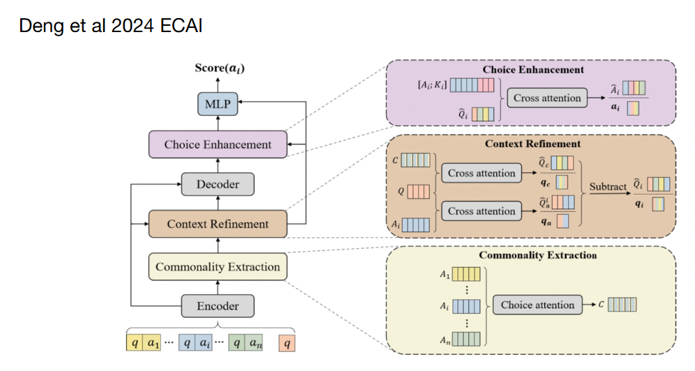

Standard BERT MCQ:

1. [CLS] question [SEP] choice_i [SEP]
2. BERT
3. CLS vector
4. linear layer
5. score(choice_i)

Fancy BERT MCQ: (Differentiating Choices via Commonality for Multiple-Choice Question Answering)

Structure:

### Layer Details: Deng et al. DCQA

Question: $q$  
Choices: $a_1, a_2, \ldots, a_n$

- Context Representation
  - Encode the question alone:
    - $Q = \operatorname{Encoder}(q)$
    - $Q \in \mathbb{R}^{l \times d}$
  - Encode each question-choice pair:
    - $A_i = \operatorname{Encoder}(q + a_i)$
    - $A_i \in \mathbb{R}^{m \times d}$

- Commonality Extraction
  - Compare every choice with every other choice.
  - This is their **choice attention**.
  - For choice $i$ attending to choice $j$:
    - $S_{ij} = \operatorname{softmax}(A_i W_{ij} A_j^\top)$
  - Use $S_{ij}$ to pull shared information from $A_j$:
    - $S_{ij}A_j$
  - Aggregate over all pairwise choice comparisons:
    - $C = \frac{1}{n}\sum_i \sum_{j \ne i} S_{ij}A_j$
  - $C$ is the commonality representation.
  - Intuition:
    - $C \approx$ “what the answer choices share”

- Context Refinement
  - Goal:
    - Find which parts of the question relate to each choice.
    - Subtract the parts that relate to commonality.
  - Cross-attention between question and commonality:
    - $\hat{Q}^c, q^c = \operatorname{Att}_{cross}(Q; C)$
  - Cross-attention between question and each choice:
    - $\hat{Q}_i^a, q_i^a = \operatorname{Att}_{cross}(Q; A_i)$
  - Remove commonality-related question information:
    - $\hat{Q}_i = \hat{Q}_i^a - \hat{Q}^c$
    - $q_i = q_i^a - q^c$
  - Intuition:
    - refined question for choice $i$ = “question features relevant to choice $i$, minus features relevant to all choices”

- Decoder
  - Use the refined question representation to generate/activate extra contextual information:
    - $K_i = \operatorname{Decoder}(\hat{Q}_i)$
  - Intuition:
    - $K_i \approx$ generated clue/context for this specific choice

- Choice Enhancement
  - Enhance the choice using both:
    - original choice representation $A_i$
    - generated clue/context $K_i$
  - Concatenate:
    - $[A_i; K_i]$
  - Cross-attend this against the refined question:
    - $\hat{A}_i, a_i = \operatorname{Att}_{cross}([A_i; K_i]; \hat{Q}_i)$

- Scoring
  - Combine:
    - $q_i$ = refined question vector for choice $i$
    - $a_i$ = enhanced choice vector for choice $i$
  - Score:
    - $\operatorname{score}(a_i) = \operatorname{softmax}(\operatorname{MLP}([q_i; a_i]))$
  - Choose the answer with the highest score.


# Wk 9 Transformer

## Issues with RNN

(This section is just because I wanted a record of keywords from the lecture)

Lack of parallelism across time steps within each sequence.
- Sequential dependency: cannot begin step t until step t-1 is complete.
- GPU Underutilisation: RNNs force sequential processing
- Training on long sequences becomes untenable due to time constraints

Transformers are able to process all tokens in all sequences at once (during training). Information flow is controlled by causal masking.

This means:
- Every token attends to every other token (O(1) path length)
- No sequential bottleneck
- "Variable" memory as the entire sequence can be queried for relevant context (dynamic attention routing)

## Queries Key and Values

Let $\mathcal D = \{(\mathbf k_1,\mathbf v_1), \dots, (\mathbf k_m,\mathbf v_m)\}$

Define attention over $\mathcal D$ as:

$$
\text{Attention}(\mathbf q, \mathcal D) \stackrel{\textrm{def}}{=} \sum_{i=1}^m \alpha (\mathbf q, \mathbf k_i) \mathbf v_i
$$

Where each $\alpha(\mathbf{q}, \mathbf{k}_i) \in \mathbb{R}$ are a scalar attention weight. ($i = 1, \ldots, m$)

To ensure all attention weights sum to 1 and are non-negative we just apply the softmax function:

$$
\alpha(\mathbf{q}, \mathbf{k}_i) = \frac{\exp(a(\mathbf{q}, \mathbf{k}_i))}{\sum_j \exp(a(\mathbf{q}, \mathbf{k}_j))}.
$$


To get a final value we use attention pooling:

$$
o = \alpha_1 v_1 + \alpha_2 v_2 + \alpha_3 v_3
$$

## Attention Scoring Functions

### Scaled Dot Production Attention

Assume all elements of query $\mathbf{q} \in \mathbb{R}^d$ and key $\mathbf{k}_i \in \mathbb{R}^d$ are i.i.d. with zero mean and unit variance. The dot product between both vectors has zero mean and unit variance. Therefore to ensure the variance of the dot product remains 1 regardless of vector lenght, we rescale using $1/\sqrt{d}$:

$$
a(\mathbf{q}, \mathbf{k}_i) = \frac{\mathbf{q}^\top \mathbf{k}_i}{\sqrt{d}}
$$

This means overall we get:

$$
\alpha(\mathbf{q}, \mathbf{k}_i) = \mathrm{softmax}(a(\mathbf{q}, \mathbf{k}_i)) = \frac{\exp(\mathbf{q}^\top \mathbf{k}_i / \sqrt{d})}{\sum_{j=1} \exp(\mathbf{q}^\top \mathbf{k}_j / \sqrt{d})}.
$$

Otherwise written as: ($n$ queries and $m$ key-value pairs, where queries and keys are of length $d$ and values are of length $v$)

$$
\mathrm{softmax}\left(\frac{\mathbf Q \mathbf K^\top }{\sqrt{d}}\right) \mathbf V \in \mathbb{R}^{n\times v}
$$

### Multilayer Perceptron Attention (Additive Attention)

Used when $q \in \mathbb R^q$ and $k \in \mathbb R^k$ are different dimensions so dot product not possible.

One option is to address the mismatch with $\mathbf{q}^\top \mathbf{M} \mathbf{k}$ or alternatively we can use additive attention:

$$
a(\mathbf q, \mathbf k) = \mathbf v^\top \textrm{tanh}(\mathbf W_q\mathbf q + \mathbf W_k \mathbf k) \in \mathbb{R}
$$

Where $\mathbf W_q\in\mathbb R^{h\times q}$, $\mathbf W_k\in\mathbb R^{h\times k}$, $\mathbf v\in\mathbb R^{h}$.

We then feed through softmax...

Note don't get confused with the value vector from transformer attention:
| Symbol                        | Meaning                                  | Used where?    |
| ----------------------------- | ---------------------------------------- | -------------- |
| $\mathbf v \in \mathbb R^h$ | **learned parameter vector** for scoring | before softmax |
| $\mathbf V$ or $v_i$       | **value vectors** being pooled           | after softmax  |

## Seq2Seq With Attention (Bahdanau Attention Mechanism)

Dynamically update context variable $c$ as a function of original text (hidden encoder states $h_t$) and text that has been generated (decoder states $s_{t'-1}$). This yields $c_{t'}$ which is updated after any decoding time step $t'$.

Assuming input sequence of length $T$, then:

$$
\mathbf{c}_{t'} = \sum_{t=1}^{T} \alpha(\mathbf{s}_{t' - 1}, \mathbf{h}_{t}) \mathbf{h}_{t}
$$

Note attention weight $\alpha$ is generated using additive attention scoring.

Old writeup:

Basically use the output of the encoder model (T, d) as the keys/values and use the current hidden state of the decoder model as the query.

I.e., $K_i = h_i^{enc}$, $V_i = h_i^{enc}$ or linear projections of them.

Then decoder hidden state $h_t^{dec}$ is used as the query $q_t = h_t^{dec}$ or a linear projection of it.

The our given query over $i$ our keys gives us our context variable $c$:

$$\alpha (q, k_i) = \text{softmax}_i \left ( \frac{q^\top k_i}{\sqrt{d_k}} \right)$$

$$c_t = \sum_i \alpha_{t,i} \cdot v_i$$

Which conditions on every decoder step.

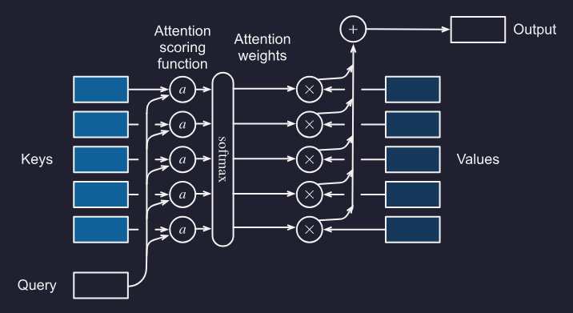

## Positional Encoding

Let $\mathbf X \in \mathbb R^{n\times d}$ with $d$-dimensional embeddings for $n$ tokens of a sequence.

We then form a positional encoding matrix $\mathbf P \in \mathbb R^{n\times d}$:

$$ p_{i,k} =
\begin{cases}
\sin\left(\dfrac{i}{10000^{k/d}}\right), & k \text{ is even} \\
\cos\left(\dfrac{i}{10000^{(k-1)/d}}\right), & k \text{ is odd}
\end{cases}
$$

Intuitively:
- The position in the sequence $i$ is our "x" axis.
- $k$ and $d$  control the period of the wave. As we walk through the embedding dimension we increase the period of the sine wave (we monotonically decrease frequency along the encoding dimension).

### Absolute positional information

Each position/time step gets a distinct pattern across the positional encoding dimensions.

Binary analog:
```
0 = 000
1 = 001
2 = 010
3 = 011
4 = 100
5 = 101
6 = 110
7 = 111
```

Sinusoidal positional encoding does something similar, but with smooth waves instead of bits:

```
Early dimensions: high frequency = change quickly with position
Later dimensions: low frequency = change slowly with position
```

### Relative positional information

For a fixed offset $\delta$, there is a matrix $M_{\delta,j}$ such that:

$$ M_{\delta,j}
\begin{bmatrix}
p_{i,2j} \\
p_{i,2j+1}
\end{bmatrix} = \begin{bmatrix}
p_{i+\delta,2j} \\
p_{i+\delta,2j+1}
\end{bmatrix}
$$

Explanation for this property found at end of document.

<div style="height: 500px;"></div>


## (convenience function) Masked Softmax Operation

When applying attention to sequence models, we may need to deal with sequences of different lengths:

```
Dive  into  Deep    Learning
Learn to    code    <blank>
Hello world <blank> <blank>
```

We need to limit $\sum_{i=1}^n \alpha(\mathbf{q}, \mathbf{k}_i) \mathbf{v}_i$ to $\sum_{i=1}^l \alpha(\mathbf{q}, \mathbf{k}_i) \mathbf{v}_i$ however long $l \leq n$, the actual sentence is.


## Relative positional information explanation

Use a 4-dimensional example:

$$ \vec v_t = \begin{bmatrix}
\sin(t) \\
\cos(t) \\
\sin\left(\frac{t}{\eta_1}\right) \\
\cos\left(\frac{t}{\eta_1}\right)
\end{bmatrix}
$$

After shifting by a fixed offset $\delta$:

$$ \vec v_{t+\delta} = \begin{bmatrix}
\sin(t+\delta) \\
\cos(t+\delta) \\
\sin\left(\frac{t+\delta}{\eta_1}\right) \\
\cos\left(\frac{t+\delta}{\eta_1}\right)
\end{bmatrix}
$$

Using:

$$
\sin(\alpha+\beta)=\sin(\alpha)\cos(\beta)+\cos(\alpha)\sin(\beta)
$$

$$
\cos(\alpha+\beta)=\cos(\alpha)\cos(\beta)-\sin(\alpha)\sin(\beta)
$$

we get:

$$ \vec v_{t+\delta} =
\begin{bmatrix}
\sin(t)\cos(\delta) + \cos(t)\sin(\delta) \\
\cos(t)\cos(\delta) - \sin(t)\sin(\delta) \\
\sin\left(\frac{t}{\eta_1}\right)\cos\left(\frac{\delta}{\eta_1}\right)
+ \cos\left(\frac{t}{\eta_1}\right)\sin\left(\frac{\delta}{\eta_1}\right) \\
\cos\left(\frac{t}{\eta_1}\right)\cos\left(\frac{\delta}{\eta_1}\right)
- \sin\left(\frac{t}{\eta_1}\right)\sin\left(\frac{\delta}{\eta_1}\right)
\end{bmatrix}
$$

This can be written as a matrix multiplication:

$$ \vec v_{t+\delta} =
\begin{bmatrix}
\cos(\delta) & \sin(\delta) & 0 & 0 \\
-\sin(\delta) & \cos(\delta) & 0 & 0 \\
0 & 0 & \cos\left(\frac{\delta}{\eta_1}\right) & \sin\left(\frac{\delta}{\eta_1}\right) \\
0 & 0 & -\sin\left(\frac{\delta}{\eta_1}\right) & \cos\left(\frac{\delta}{\eta_1}\right)
\end{bmatrix}
\begin{bmatrix}
\sin(t) \\
\cos(t) \\
\sin\left(\frac{t}{\eta_1}\right) \\
\cos\left(\frac{t}{\eta_1}\right)
\end{bmatrix}
$$

So:

$$ \vec v_{t+\delta} = M_\delta \vec v_t
$$

The key idea is that for any fixed relative offset $\delta$, the same matrix $M_\delta$ maps the positional encoding at position $t$ to the positional encoding at position $t+\delta$.

$M_\delta$ depends on $\delta$, but not on $t$.


# 9.1 Transformer

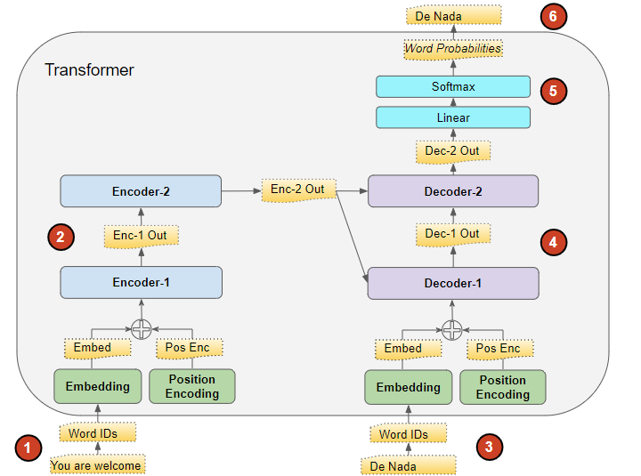

## Overview

First note that a GPT-style transformer is a decoder-only transformer:
- Each token can attend only to previous tokens, because of the causal mask $x_t \text{ can attend to } x_1, \dots x_t$.

For machine translation (e.g., $\text{english} \rightarrow \text{french}$), a encoder-decoder transformer is used:
- No causal mask is used on the encoder. Each encoder token can attend to all other input tokens.
- A causal mask is used on the decoder. The decoder can attend to previous output tokens and the encoder's representation of the full input sequence.
- The encoder stack and decoder stack get their own embedding layers (you wouldn't use english embeddings on french tokens).

Note how both encoder and decoder input get position encoding.

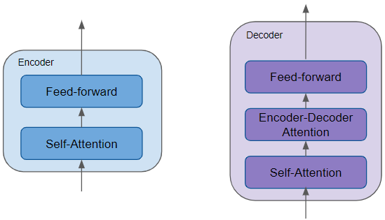

## Layer Details

Include residual connection + layer norm around each attention/FFN sublayer.

- Encoder (encoder-decoder transformer)
  - Unmasked self-attention
    - $Q = H_{enc}W_Q$ 
    - $K = H_{enc}W_K$
    - $V = H_{enc}W_V$
  - FFN
- Decoder (encoder-decoder tranformer)
  - Masked self-attention
  - Encoder-decoder attention (don't need masking here because of the prior masking)
    - The prior self-attention output is the query and the encoder output is the key and value.
    - $Q = H_{dec}W_Q$ 
    - $K = H_{enc}W_K$
    - $V = H_{enc}W_V$
  - FFN
- Decoder (Decoder-only transformer):
  - Masked self-attention
  - FFN

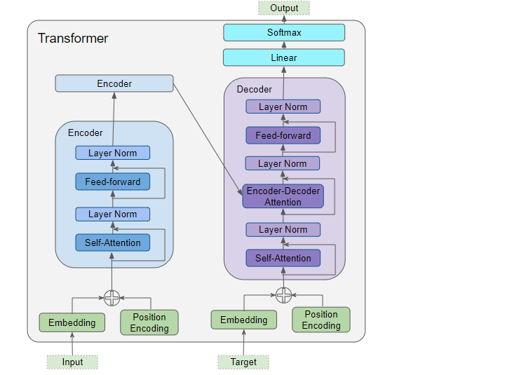

## FFN

We have (B, L, d_model). We apply a 2-layer MLP to d_model only.

This will look like `[d_model] → [d_ff] → [d_model]`.

If `d_model` is 512, we may end up projecting to `d_ff` 2048 then back down to 512.

```python
import jax
import jax.numpy as jnp

def ffn(x, W1, b1, W2, b2):
    """
    x:  [B, T, d_model]
    W1: [d_model, d_ff]
    b1: [d_ff]
    W2: [d_ff, d_model]
    b2: [d_model]
    """

    h = jax.nn.gelu(x @ W1 + b1)  # [B, T, d_ff]
    y = h @ W2 + b2               # [B, T, d_model]

    return y
```


# Wk 10 LLM

## Perplexity
(recap from wk 6 notes)

Perplexity is the exponential of cross-entropy averaged over all timesteps, so that sequences of varying timesteps are comparable

We need some way of comparing loss between variable length sequences. This is defined as perplexity:

Let $x_{<t} = x_1, \dots, x_{t-1}$ and $V$ be all possible tokens.

$$ \text{Perplexity} = \exp\left(- \frac{1}{n} \sum_{t=1}^n \sum_{v \in V} P(v \mid x_{<t}) \cdot \ln \hat{P}(v \mid x_{<t}) \right)
$$

Which when one-hot encoded:

$$ \text{Perplexity} = \exp\left(- \frac{1}{n} \sum_{t=1}^n\cdot \ln \hat{P}(x_t \mid x_{<t}) \right)
$$

By example, suppose:
- $P(w_1 \mid w_0) = \frac{1}{4}$
- $P(w_2 \mid w_1, w_0) = \frac{1}{3}$
- $P(w_3 \mid w_2, w_1, w_0) = \frac{1}{4}$

Then:

$$ \text{Perplexity} =
\exp\left(
-\frac{1}{3}
\left(
\log \frac{1}{4}
+
\log \frac{1}{3}
+
\log \frac{1}{4}
\right)
\right)
\approx 7.28
$$

## Definitions

- Bitter lesson: scalable general methods tend to beat hand-engineered methods
- Scaling law: Larger models trained on more data with more compute yield better results

## Pretraining

Train model on X, fine-tune on Y.

For language models, pre-training usually means learning from large text corpora using a self-supervised objective, such as:

- **GPT:** predict the next token  
  $P(x_t \mid x_{<t})$

- **BERT:** predict masked tokens using surrounding context  
  $P(x_{\text{mask}} \mid x_{\text{left}}, x_{\text{right}})$

After pre-training, the model has learned general language representations. It can then be adapted to a specific task by **fine-tuning** or by adding a task-specific head.


# Wk 11 LLM

## "Train on the Web"

### Data Sources

- Must websites are useless gibberish
- Consider:
  - Oversampling good sites (Wikipedia, arXiv, GitHub)
  - Filter based on known heuristics (Upvotes, PageRank)
  - Ask an LLM to "asses quality" and distill into a tiny model
- Remaining pages still need a ton of cleaning and deduplication (HTML, JavaScript, Boilerplate --> clean text for next token prediction)

### Training Curriculum

- Use broad general dataset mostly from the web for early training
- Use higher-quality, more code/math-heavy dataset to sharpen reasoning and programming ability for late training

For SmolLM3:

| Phase         |                               Purpose |     Token count | Data mix                                             |
| ------------- | ------------------------------------: | --------------: | ---------------------------------------------------- |
| **Phase I**   |                         Base training |   **8T tokens** | Mostly web: **85% web, 12% code, 3% math**           |
| **Phase II**  |                High-quality injection |   **2T tokens** | More curated data: **75% web, 15% code, 10% math**   |
| **Phase III** | Learning-rate decay / final polishing | **1.1T tokens** | Even more code/math: **63% web, 24% code, 13% math** |

### LLM Evaluation is becoming Unreliable

**Contamination**: Benchmarks/test questions may appear in the pretraining data

**Explicit hill-climbing**: Labs train/validate directly against popular benchmarks

**Emergence**: As models get bigger, some abilities appear suddenly, so a benchmark may fail to predict when a model is about to become good at something. (The benchmark does not give a smooth, useful picture of progress)

## Decision Making when training NNs

Which data, architecture or hyperparams to use?

**Idea #1**: Train M modes with 1/M the budget each.
- Pick the best performing one.
- But your model only used 1/30 of your budget.

**Idea #2**: Tune hyperparams at small scale.
- "This drug dose worked in mice, so use the same dose in humans."
- But hyperparam choice at small scale does not scale to large scale easily

**Idea #3**: Scaling laws.
- "Measure how dose-response changes with body size, then predict the human dose."
- Maybe we train and tune may smaller models with small amounts of data and extrapolate

## Power Law

### Overview

Shown empirically.

$$L(X) = X^{-\alpha}$$

- $X$ is the resource being scaled
- $L(X)$ is the validation/test loss after training with that amount of resource
- $\alpha$ is the scaling component (model/dataset dependent)

$X$ might be:
- $\text{Dataset size (D)}$:
  - $D$ is the number of training tokens
  - $D=\text{batch size}\cdot \text{sequence length} \cdot \text{training steps}$
  - $L(D) = D^{-\alpha}$
- $\text{Compute (C)}$:
  - $N$ is number of training parameters
  - $D$ is the number of training tokens
  - $C \approx 6ND$ (2 flops per param, need forward pass, backward pass, update grads)

Usually you count both:

$$
L(N, D) = L_\infty + \frac{A}{N^\alpha} + \frac{B}{D^\beta}
$$

- $N$ is the **number of model parameters**.
- $D$ is the **number of training tokens / data size**.
- $L(N,D)$ is the **expected validation/test loss** after training with model size $N$ and data size $D$. I.e., the negative log-likelihood (log perplexity)
- $E$, $A$, $B$, $\alpha$, $\beta$ are fitted values
  - $L_\infty$ is the **irreducible loss floor**, i.e. the best possible loss even with infinite model/data.
  - $A$ is the **coefficient for model-size-limited loss**.
  - $\alpha$ is the **scaling exponent for model size**, i.e. how fast loss improves as $N$ increases.
  - $B$ is the **coefficient for data-limited loss**.
  - $\beta$ is the **scaling exponent for data size**, i.e. how fast loss improves as $D$ increases.

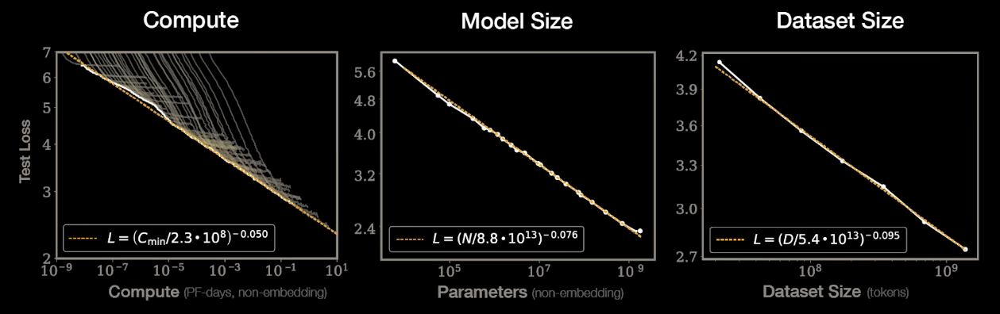

### How to find optimal N and D

1. Try several model sizes $N$ (e.g., 100M, 300M, 1B, 3B)
2. For each $N$, train for different $D$ (e.g., 20B, 60B, 180B tokens)
3. Record loss and compute cost 

Material example:

Say we have the following loss equation:

$$
L(N,D) = 1.8 + \frac{0.4}{\sqrt{N}} + \frac{1.79}{\sqrt{D}}
$$

Where compute is roughly $C = 6ND$

Say we fix compute at $C = 600$, then $ND = 100$

#### Step 1: Try different model sizes

All of which use the same compute (100)

| (N) params | Required (D) tokens | Why                           |
| ---------: | ------------------: | ----------------------------- |
|       0.5B |                200B | small model, lots of data     |
|         1B |                100B | medium-small model            |
|         2B |                 50B | balanced-ish                  |
|         5B |                 20B | large model, less data        |
|        10B |                 10B | very large model, little data |

#### Step 2: Determine loss using loss equation

|  (N) |  (D) |      Loss |
| ---: | ---: | --------: |
| 0.5B | 200B |     2.492 |
|   1B | 100B |     2.379 |
|   2B |  50B | **2.336** |
|   5B |  20B |     2.379 |
|  10B |  10B |     2.493 |

So for compute budget $C = 600$, then best allocation is $N_{\text{opt}}, D_{\text{opt}} = (2B, 50B)$

#### Step 3: Repeat 1 and 2 for varying compute budgets

| Compute (C) | Best (N) | Best (D) |
| ----------: | -------: | -------: |
|         150 |    ~1.1B |     ~22B |
|         600 |    ~2.2B |     ~45B |
|        2400 |    ~4.5B |     ~89B |

Now fit a curve for:

$$
N_\text{opt} \propto C^a\qquad \text{and}\qquad D_\text{opt} \propto C^b
$$

## Takeaways from Kaplan et al. (2020)

- Test loss scales as power law of data, parameter count, and compute...
- Test loss is more sensitive to parameter count than data (later disputed)
- Larger models require less data to reach same performance, so don't train to convergence, instead train larger models for fewer steps

Overall this means: as compute increases, you should spend proportionally more of it on parameters than on extra data.

I.e., bigger model, fewer tokens per parameter. Which is the regime chosen by GPT3 (2 tokens/param) vs say Chinchilla (20 tokens/param) or Llama 2 70B (29 tokens/param)

## Chinchilla enters the room. (2022)

- Deepmind confirmed power-law scaling
- Disputed optimal allocation between data and parameters

Chinchilla found that the compute-optimal strategy is roughly:

$$
N_\text{opt} \propto C^{0.5}\qquad \text{and}\qquad D_\text{opt} \propto C^{0.5}
$$

So if compute increases by $4\times$, then roughly:
- model size $N$ should increase by $2\times$
- data $D$ should increase by $2\times$

## Intentional overtraining

Intentionally overtraining a small model may be desirable as it will be cheaper to run during inference. Therefore there is a shift towards overtraining.

| Model | Tokens per parameter |
|---|---:|
| GPT-3 | 2 |
| Chinchilla | 20 |
| LLaMA 65B | 22 |
| Llama 2 70B | 29 |
| Mistral 7B | 110 |
| Llama 3 70B | 215 |


## Power law diminishing returns...

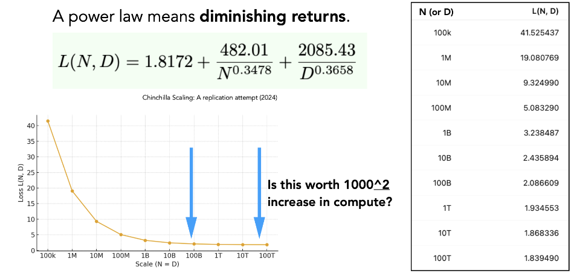

## Surprising performance from smaller models surpassing what pure scaling predicts

Number of ways to achieve this:

### 1. Training Curriculum (copied from above)

- Use broad general dataset mostly from the web for early training
  - Learn language and build very strong priors in earlier stages
- Use higher-quality, more code/math-heavy dataset to sharpen reasoning and programming ability for late training
  - Learn "high-quality" bias to get the behaviour we actually want

For SmolLM3:

| Phase         |                               Purpose |     Token count | Data mix                                             |
| ------------- | ------------------------------------: | --------------: | ---------------------------------------------------- |
| **Phase I**   |                         Base training |   **8T tokens** | Mostly web: **85% web, 12% code, 3% math**           |
| **Phase II**  |                High-quality injection |   **2T tokens** | More curated data: **75% web, 15% code, 10% math**   |
| **Phase III** | Learning-rate decay / final polishing | **1.1T tokens** | Even more code/math: **63% web, 24% code, 13% math** |

### 2. User/Assistant Templates

Native separation between system/user/assistant turns.

```
<|im_start|>system
broad system instructions
<|im_end|>

<|im_start|>user
User request.
<|im_end|>

<|im_start|>assistant
Visible response!
<|im_end|>
```

### 3. Supervised fine-tuning (SFT) using demonstrations of desired behaviour

Loss function is identical to pretraining.

However during SFT loss is applied mainly to answer/output tokens, not prompt tokens.

How to get SFT data?
- Actual deployed interactions
- Data vendsors, based on detailed specifications
- Use existing LLMs + complex processes to synthesize stuff

#### LIMA: Less Is More for Alignment

- Idea is that model learns most factual/world knowledge during pretraining
- SFT is just for focusing the style of the model
- So you only need a small number of high-quality instruction examples to teach the model how to express/use the knowledge it already has

Because only a few SFT examples are needed, every example can have a big effect on behaviour.

For example:

1. ```
    Q: What is the population of <small town> in Mar ’26?
    A: 23,241 people
    ```
    Model may learn that, for specific factual questions, give a precise answer confidently. But the population of a small town at a future date may be uncertain, unavailable, or outdated. A better assistant might say `I'd need a current source to answer that accurately`.

2. ```
    Q: What is the capital city of the US?
    A: Washington, D.C.
    ```
    This is safer because it is a stable, common fact. The model may learn `for simple stable factual questions, answer directly` which is probably desired.

## Reinforcement Learning

### Challenges with SFT

- What if there are many OK answers?
- What if model's answer is better than our human label?

Can the model actually learn the underlying process, which is required for generalisation, from a bunch of demonstrations?

Enter RL.

### RL for Human Feedback (RLHF)

Show annotators multiple responses and are them to rank from best to worst

### RL from "Verifiable" Rewards

Implement scalar reward function $R(x,y)$
- $x$ is prompt/question
- $y$ is model's proposed answer
- Can be binary or give partial credit

### Rejection Fine-Tuning (RFT)

**Offline** (data generation and training are separate)

1. Take current model
2. For each prompt, sample K answers
3. Score answers with R(x,y)
4. Keep good answers
5. Make a fixed dataset of <x, good y>
6. Run SFT for many gradient steps/epochs on that dataset

**Online** (interleave data generation and training)

repeat:
 1. Take current model
 2. Sample answers for a batch of prompts
 3. Score with R(x,y)
 4. Keep/use high-reward answers
 5. Take one or more SFT gradient steps

**Problems with RFT**
1. We don't learn from failed examples
2. We may memorise sub-optimal answers from early in training and fail to progress further
3. We may diverge too far from the original model in a way that hinders generalisation to *other* distribution tasks

### Policy Gradient Algorithms (REINFORCE)

$$ \nabla_\theta \mathbb{E}\left[ R(x,y) \right] =
\mathbb{E}\left[ R(x,y)\,\nabla_\theta \log \pi_\theta(y \mid x) \right]
$$

LHS: gradient of the model’s average reward

RHS: estimate that gradient using the gradient of the log-probability that the model assigned to the sampled answer, weighted by reward

Thererfore if y got high reward:
- increase $\log \pi_\theta(y \mid x)$
- → make that answer more likely next time

If y got low reward:
- weak/no increase
- → don't reinforce that answer